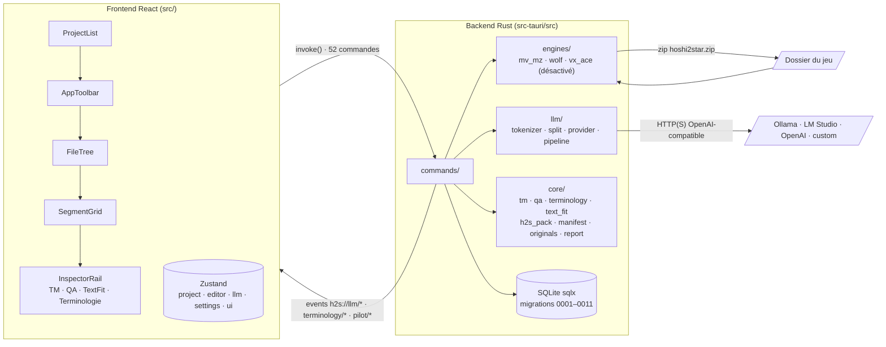

# Analyse complète de Hoshi2Star — rapport

**Plan :** `docs/plans/2026-10-25-analyse-complete-app.md`.
**Base analysée :** `main` @ `340e636` (v0.4.10), Rust ~47 k lignes (`src-tauri/src`), TS ~17 k lignes (`src/`).

| Session | Date | Outil | Sections |
|---|---|---|---|
| 1 — carte et contrôles automatiques | 2026-10-25 | Claude | Architecture, Menaces, Constats statiques, À confirmer sur jeux réels |
| 2 — parcours réels sur jeux | à faire | | Parcours réels |
| 3 — vérifications ciblées et rapport final | à faire | | Synthèse, liste priorisée, lots |

## Lecture du rapport

**Statut de chaque constat :**
- **vérifié-exéc.** : prouvé par une commande exécutée pendant la session (sortie d'outil).
- **vérifié-code** : le code lu suffit à prouver le mécanisme. L'effet réel n'a pas été déclenché. Les constats marqués « relu » ont été relus à la main par la session principale, en plus du sous-agent qui les a trouvés.
- **déduit** : raisonnement sur le code, sans preuve complète.
- **inconnu** : non déterminé.

**Gravité :**
- **bloquant** : corruption du jeu ou perte de traduction probable en usage normal.
- **majeur** : corruption, perte ou plantage atteignable avec une entrée réaliste ou forgée.
- **mineur** : défaut limité ou contourné.
- **info** : à savoir, pas à corriger en priorité.

**Méthode de la session 1 :**
- Cinq sous-agents en lecture seule, un par couche : engines, export, llm, core/commandes/base, UI.
- Relecture manuelle des constats majeurs.
- Contrôles automatiques, résultats bruts résumés dans la section « Constats statiques ».

Aucun code applicatif n'a été modifié et aucun jeu réel n'a été ouvert.
Sorties brutes des outils : `docs/audit/2026-10-analyse-complete.preuves.txt`.

---

## Architecture

### Vue d'ensemble

### Couches

| Couche | Modules et entrées principales | Rôle |
|---|---|---|
| Commandes | `lib.rs:67`, un seul `generate_handler!` de 52 commandes. Projet, recherche, QA/TM, terminologie (15), couverture, text-fit, export, packs, pilote, traduction. Elles sont toutes appelables depuis la fenêtre `main` (pas de manifeste d'app restreint). | Frontière IPC |
| Engines MV/MZ | `mv_mz/extractor.rs` (un extracteur par type de fichier), `json_span.rs` (parseur JSON maison qui garde les octets, profondeur ≤ 128), `plugins_js.rs`, `keke.rs`, `coverage/`, `layout/` (géométrie `System.json`, polices WOFF/TTF), `profiles.rs` (TOML embarqués) | Extraction JSON → `Segment` |
| Engines Wolf | `wolf/decrypt/legacy_xor.rs` (DXA v5/v6/v8 : XOR, Huffman, LZ), `dat_parser.rs` (`.project`/`.dat`, LZ4 si 0xC4), `v3_format/` (`.mps`/`CommonEvent.dat` v3 maison, d'après WolfTL), `extractor.rs` (crate `wolfrpg-map-parser` forkée pour la v2, sous `catch_unwind`) | Extraction binaire → `Segment` |
| Engines VX Ace | `vx_ace/` via `marshal-rs`. Détection commentée (`detector.rs:143`). | Inactif |
| LLM | Une seule passe, la traduction (`pipeline.rs:1`). Un seul fournisseur, `OpenAiCompatibleProvider` (`provider.rs:194`), avec des préréglages ollama, lmstudio, huggingface, openai, custom. DeepL et DeepSeek n'existent pas en tant que fournisseurs dédiés. | Traduction automatique |
| Core | `tm.rs` (TM globale : SHA-256 de `trim+lowercase`, floue par Levenshtein en mémoire), `qa.rs` (contrôles structurels et sémantiques), `terminology/`, `text_fit.rs`, `h2s_pack.rs`, `manifest.rs`, `originals.rs` (snapshot MV/MZ vérifié par sha256), `report.rs` | Métier |
| Base | SQLite, 5 connexions, `foreign_keys(true)`, `journal_mode` non fixé (DELETE par défaut). Tables `projects` → `source_files` → `segments` (CASCADE), `tm_entries` (UNIQUE `source_hash, lang_pair`), terminologie (0008/0009), catégories (0010), text-fit (0011). | Persistance |
| UI | Routage par `ui.mode` : library, patch, terminology, player et images (ces deux derniers à venir). Stores `project`, `editor`, `llm`, `settings`, `ui`, `search`, `coverage`, `textFit`, `pilot`, `updater`. TanStack Query pour TM, QA, terminologie et polices. | Éditeur CAT |

### Flux principaux

1. **Ouvrir/extraire.** `open_project` (`commands/project.rs:52`) lit `.hoshi2star.json`, sinon crée un projet. L'extraction tourne dans `spawn_blocking` (:158), puis tout est inséré en une seule transaction, et le manifeste est écrit dans le dossier du jeu.
2. **Traduire.** `translate_segments` / `translate_all_segments` (`commands/translate.rs:24`, `:162`) lancent `tokio::spawn`, sans handle conservé. Ensuite :
   - réutilisation canonique, puis TM exacte ;
   - tokenisation `⟦ph_N⟧` (numérotée par segment) ;
   - paquets par classe ;
   - `llm_translate_with_split` : 3 essais, puis découpage récursif ;
   - analyse stricte de la réponse ;
   - `restore`, puis QA, avec au plus 2 relances sémantiques ;
   - `persist_batch_results` en une transaction.
3. **QA.** `check_segment` (structure) et `check_with_context` (sémantique). L'export appelle `audit_project` : un segment critique bloque l'export.
4. **Exporter.** `export_project` (`commands/export.rs:272`) écrit un zip `<jeu>/hoshi2star.zip` :
   - MV/MZ : injection dans le snapshot vierge, puis contrôle d'intégrité des valeurs ;
   - Wolf et VX Ace : injection à partir des fichiers **présents dans le dossier du jeu** ;
   - le joueur dézippe lui-même par-dessus le jeu. Aucune commande de restauration.
5. **Packs .h2s.** Lecture du zip en mémoire, puis écriture en base seulement, après un pack de sauvegarde.

### Zones les plus corrigées (historique Git)

Sur 320 commits, 36 sont des `fix`. Fichiers les plus touchés par ces correctifs :
- `commands/project.rs` (8), `commands/export.rs` (6), `SegmentGrid.tsx` (6) ;
- `wolf/dat_parser.rs` (5), `types.ts` (5) ;
- `tokenizer.rs`, `pipeline.rs`, `lib.rs`, `report.rs`, `qa.rs` (4 chacun).

Plusieurs constats ci-dessous tombent dans ces mêmes fichiers.

---

## Menaces

### Actifs à protéger, par ordre d'impact

1. **Fichiers du jeu** après application du zip : un jeu corrompu ou un texte écrit au mauvais endroit.
2. **Traductions** en base (travail humain et coût LLM).
3. **Poste de l'utilisateur** : lecture ou écriture de fichiers hors du jeu, plantage, gel.
4. **Clé API** du fournisseur LLM.

### Entrées non fiables et frontières

| Entrée | Qui la contrôle | Où elle est lue | Protections constatées | Risques résiduels |
|---|---|---|---|---|
| JSON MV/MZ (`data/*.json`) | Auteur du jeu, ou un tiers pour un jeu téléchargé | `serde_json`, extracteurs | Limite de récursion de serde | BOM non géré (S-E10) |
| `plugins.js` | Idem | `json_span` | Profondeur 128, noms de plugins assainis (`coverage.rs:305`) | Première affectation prise même dans un commentaire (info) |
| `System.json` → police | Idem | `text_fit.rs:141`, `geometry.rs:101` | **Aucune** sur le chemin | Lecture hors du jeu, `/dev/zero` (S-E3) |
| Police WOFF/TTF | Idem | `layout/font.rs` | Plafond 64 Mio, bombe zlib bornée | Boucle sans fin (S-E4) |
| Archives `.wolf` DXA v5/v6/v8 | Idem | `legacy_xor.rs` | Offsets en `checked_add`, sorties ≤ 1 Gio | Cycle de répertoires (S-E1), amplification (S-E5) |
| `.dat` / `.project` Wolf | Idem | `dat_parser.rs` | `read_bytes` borné, `bounded_cap` | `data_count` sans consommation (S-E6), LZ4 sans plafond (S-E7) |
| `.mps` / `CommonEvent.dat` v3 | Idem | `v3_format/` | `ByteReader::take` vérifié | `with_capacity(u32 lu)` qui fait avorter (S-E2) |
| `.mps` v2 | Idem | crate forkée | `catch_unwind` | Boucles et allocations non auditées (inconnu) |
| Ruby Marshal (VX Ace) | Idem | `marshal-rs` | aucune | Inactif ; à traiter avant réactivation (S-E9) |
| Pack `.h2s` reçu d'autrui | Un autre traducteur | `h2s_pack.rs:191` | Lu en mémoire (pas de zip slip), noms d'entrée fixes, 256 Mo par entrée, écrit seulement sur des `(fichier, clé)` existants | Pas d'atteinte au disque. Cibles importées → barrière QA de l'export. |
| `.hoshi2star.json` | Le dossier du jeu | `project.rs:60` | UUID validé avant usage comme chemin | `game_path` non comparé (S-C4) |
| Réponse du LLM | Le fournisseur, le modèle (ou le texte du jeu, par injection de prompt) | `provider.rs:713`, `:775` | Analyse stricte des ids, placeholders manquants ou dupliqués rejetés | Tokens étrangers, troncature, codes ajoutés (S-L1, S-L5, S-L7) |
| Appels IPC | La webview | 52 commandes | Requêtes SQL toutes paramétrées | Avec `csp: null` + `withGlobalTauri`, un XSS donnerait l'écriture de fichiers arbitraires via `export_tm`, `debug_*` (S-C3) |
| Réseau | Le fournisseur ou un intermédiaire | `reqwest` + rustls | TLS rustls, clé en en-tête Bearer, jamais persistée ni loggée | Avis RustSec rustls/webpki (S-D2) ; `http://` accepté vers un hôte distant (mineur) |
| Mises à jour | Releases GitHub | `tauri-plugin-updater` | Signature minisign, point d'accès HTTPS | — |

### Ce qui est hors du modèle

- Un attaquant qui contrôle déjà le compte de l'utilisateur.
- Les jeux eux-mêmes une fois lancés : Hoshi2Star ne les exécute pas.
- Le MCP bridge : `init()` seulement sous `cfg(debug_assertions)` (`lib.rs:122`). La permission reste dans `capabilities/default.json` en release, sans effet puisque le plugin n'y est pas chargé.

### Scénarios les plus crédibles

1. **Jeu mis à jour entre extraction et export** : traductions écrites sur d'autres lignes, sans erreur (S-X1, S-X4). C'est le risque n° 1 pour l'utilisateur, sans attaquant.
2. **Fournisseur LLM en panne pendant « Tout traduire »** : projet entier passé en `needs_review`, avec la source comme cible (S-L2).
3. **Jeu téléchargé piégé ou corrompu** : gel ou arrêt brutal de l'app (S-E1 à S-E7). Pas d'exécution de code identifiée.
4. **Fuite de fichier local** : un jeu piégé désigne une police hors du dossier (S-E3). Les octets ne remontent que si le fichier se lit comme une police.

---

## Constats statiques

### Contrôles automatiques

| Contrôle | Commande | Résultat | Statut |
|---|---|---|---|
| Tests frontend | `pnpm test` | 34 fichiers, 121 tests verts | vérifié-exéc. |
| Tests Rust + couverture | `cargo llvm-cov --summary-only` (LLVM système 23.1.3 = LLVM de rustc) | 691 verts, 12 ignorés ; 85,4 % des lignes | vérifié-exéc. |
| Clippy pedantic | `cargo clippy --all-targets -- -W clippy::pedantic` | Sortie 0 ; 961 avertissements, dont 759 uniques sur la lib (hors tests) | vérifié-exéc. |
| cargo audit | `cargo audit` (base RustSec du 2026-10-25) | 22 vulnérabilités, 10 avertissements | vérifié-exéc. |
| cargo deny | `cargo deny --config <scratchpad>/deny.toml check licenses sources bans` (config hors dépôt, cibles Linux + Windows) | bans ok (36 doublons en warn) ; licenses et sources en échec, voir S-D4 et S-D5 | vérifié-exéc. |
| pnpm audit | `pnpm audit` / `pnpm audit --prod` | 98 avis (1 critique, 34 hauts), dont 77 en `--prod` | vérifié-exéc. |
| Couverture TS | `@vitest/coverage-v8` | **non exécuté** : dépendance absente. Son ajout modifierait `package.json`, l'utilisateur ne l'a pas autorisé (seuls les outils cargo ont été installés). | — |
| security-review | skill `security-review`, appliqué à tout `main` faute de diff | aucune vulnérabilité retenue au seuil de 80 % | vérifié-code |

**Clippy pedantic, lints de la lib par fréquence :**
- `must_use_candidate` 157, `missing_errors_doc` 152, `doc_markdown` 96 ;
- `cast_possible_truncation` 96, `cast_sign_loss` 31, `cast_possible_wrap` 14 ;
- `too_many_lines` 29, `manual_let_else` 28, `map_unwrap_or` 23, `cast_lossless` 22, `implicit_hasher` 14, `cast_precision_loss` 11.

La majorité relève du style. Les lints qui touchent la correction :
- **conversions** dans les parseurs et écrivains binaires (`legacy_xor.rs`, `v3_format/*`, `wolf/injector.rs`, `layout/font.rs`). Les plus utiles sont repris en S-E4 et S-E8 ;
- `unchecked_time_subtraction` (`core/terminology/scanner.rs:209`, `Instant::now() - PROGRESS_INTERVAL`) : panique seulement si l'horloge monotone est plus jeune que l'intervalle. Info ;
- `float_cmp` (`layout/simulate.rs:101`) : info.

### Couverture

Mesure vérifiée par exécution le 2026-10-25 avec `cargo llvm-cov --summary-only`.

**Tests**
- 691 tests verts, 0 échec, 12 ignorés : 8 tests d'intégration et 4 de la lib.
- Les ignorés sont des tests sur jeux réels qui attendent des variables d'environnement. Ils n'ont pas été lancés.

**Total**

| Mesure | Couverture |
|---|---|
| Lignes | 85,4 % (32 141 lignes, dont 4 691 non couvertes) |
| Régions | 85,0 % |
| Fonctions | 80,1 % |

**Par module**

| Module | Lignes | Couverture |
|---|---|---|
| `commands/translate.rs` | 252 | **0 %** |
| `commands/export.rs` | 1 111 | **53,2 %** |
| `commands/terminology.rs` | 475 | 55,4 % |
| `engines/wolf/extractor.rs` | 1 134 | 58,6 % |
| `engines/wolf/decrypt/legacy_xor.rs` | 1 461 | 62,6 % |
| `engines/detector.rs` | 385 | 72,7 % |
| `commands/pack.rs` | 894 | 74,9 % |
| `llm/split.rs` | 162 | 76,5 % |
| `engines/wolf/injector.rs` | 1 097 | 79,9 % |
| `engines/mv_mz/integrity.rs` | 387 | 84,5 % |
| `engines/mv_mz` (ensemble) | 8 418 | 93,0 % |
| `llm/pipeline.rs` | 1 480 | 92,7 % |
| `llm/tokenizer.rs` | 489 | 98,6 % |
| `core/tm.rs` | 483 | 100 % |

**Lecture**
- Les zones de corruption les plus probables sont les moins couvertes :
  - l'export (`export.rs` 53 %, `wolf/injector.rs` 80 %) ;
  - l'extraction et l'injection Wolf (59 à 63 %) ;
  - la commande de traduction, qui n'est pas couverte du tout. Elle contient S-L2, S-L3, S-L4 et S-U1.
- Ces chiffres recoupent l'historique Git : `export.rs` et `project.rs` sont parmi les fichiers les plus corrigés.

**Non mesuré**
- La couverture TypeScript n'a pas été mesurée.

### Dépendances

**S-D1 — `zip` 2.4.2 : RUSTSEC-2026-0367, -0368, -0369 (SUID, liens symboliques, permissions à l'extraction).**
- Gravité : info. Statut : vérifié-code.
- Seul `ZipArchive::new` + lecture d'entrées est utilisé (`h2s_pack.rs:191`, `:224`). Jamais `extract()`, qui porte les failles.
- Correctif : `zip` ≥ 9 (rupture d'API). À planifier, sans urgence.

**S-D2 — `rustls` 0.23.40, `rustls-webpki` 0.103.13, `webpki-roots` 1.0.4 : 7 avis.**
- RUSTSEC-2026-0285 (messages de handshake acceptés entre niveaux de chiffrement), -0349 (rétrogradation de connexions ultérieures), -0382 (intermédiaires révoqués acceptés), -0381 et -0383 (racines emSign révoquées), -0346, -0348.
- Gravité : **majeur**. Statut : vérifié-exéc. (avis) / déduit (exploitation).
- Ces crates portent tout le TLS de l'app : fournisseurs LLM (clé API) et updater.
- Correctifs semver-compatibles : `cargo update -p rustls -p rustls-webpki -p webpki-roots -p webpki-root-certs`.

**S-D3 — Avis hors du chemin d'exécution.**
- `quinn-proto` (6 avis) et `rsa` (Marvin) : absents de l'arbre normal compilé (`cargo tree -e normal -i` vide).
- `quick-xml` 0.39.4 : présent seulement via `plist` → `tauri-utils`, à la compilation.
- Avertissements : `ttf-parser` non maintenu (utilisé par `layout/font.rs`) ; `glib`, `tokio`, `event-listener` unsound ; `spin` retiré (yanked).
- Gravité : info. Statut : vérifié-exéc.

**S-D4 — Licences.**
- La crate `hoshi2star` n'a pas de champ `license` dans `src-tauri/Cargo.toml`, alors qu'un `LICENSE` existe à la racine.
- `marshal-rs` 2.0.1 est sous WTFPL (permissive, mais rarement acceptée par les politiques de licence).
- Gravité : mineur. Statut : vérifié-exéc.

**S-D5 — Sources.**
- `wolfrpg-map-parser` vient d'une branche git du fork (`Cargo.toml:62`, `branch = "fix/wolf-v3-format"`), pas d'un commit fixé dans le manifeste. Seul `Cargo.lock` le fixe.
- Gravité : mineur. Statut : vérifié-exéc.

**S-D6 — npm.**
- Les 77 avis `--prod` passent tous par `shadcn` (la CLI, placée en `dependencies` alors qu'on n'importe que `shadcn/tailwind.css` dans `src/index.css:3`) ou par `@tailwindcss/vite` (outil de build).
- Les paquets concernés (hono, express/body-parser, proxy-addr critique, `@modelcontextprotocol/sdk`…) servent le serveur MCP de la CLI shadcn et ne sont pas embarqués dans le bundle.
- Côté dev : `vite`, `vitest`, `undici`, `postcss`.
- Gravité : mineur (outillage du poste de dev). Statut : vérifié-exéc. (avis) / déduit (absence du bundle, à confirmer par analyse de `dist/`).

### Engines (lecture des jeux)

**S-E1 — Boucle sans fin et OOM sur cycle de répertoires DXA v8.**
- Où : `wolf/decrypt/legacy_xor.rs:1077` (`build_per_file_key_str`) et `:1106` (`build_file_path`).
- Gravité : **majeur**. Statut : vérifié-code (relu).
- Les deux fonctions remontent `parent_dir_address / 32` tant que la valeur n'est pas `u64::MAX`, sans ensemble de visités ni profondeur maximale. Un répertoire parent de lui-même fait boucler, et `ks` / `components` grossissent jusqu'à l'OOM.
- Reproduction : test unitaire, TOC v8 en clair avec `dirs[1].parent_dir_address = 32`, sous timeout.

**S-E2 — Arrêt brutal du processus sur compteur v3 forgé.**
- Où : `wolf/v3_format/common_events.rs:133`, `:153`, `:159`, `:165`, `:176`, `:372` ; `map.rs:87`, `:93` ; `command.rs:133`.
- Gravité : **majeur**. Statut : vérifié-code / déduit (avortement).
- `Vec::with_capacity(count)` avec un `u32` lu tel quel. Un échec d'allocation fait avorter tout le processus, ni `catch_unwind` ni `spawn_blocking` ne le rattrapent.
- Reproduction : `CommonEvent.dat` v3.5 valide dont le payload LZ4 annonce `event_count = 0xFFFFFFFF`. `CommonEventsV3::parse` doit renvoyer `Err`.

**S-E3 — Chemin de police non assaini.**
- Où : `commands/text_fit.rs:141-144`, `layout/geometry.rs:101-105`, `get_game_font` (`text_fit.rs:694`).
- Gravité : **majeur**, pour le gel/OOM via `/dev/zero`. Le volet fuite de fichier n'est que du durcissement : la security-review le juge non exploitable (fichier lisible comme police seulement, octets gardés dans la webview). Statut : vérifié-code (relu).
- `game.join("fonts").join(name)`, où `name` vient de `System.json` (`advanced.mainFontFilename`). Un chemin absolu remplace la base, `..` est accepté.
- `"/dev/zero"` fait lire sans fin. Un fichier hors du jeu qui se lit comme une police est renvoyé au webview.
- Reproduction : `System.json` MZ avec `"mainFontFilename":"/dev/zero"`, puis `get_text_fit`.
- Le nom de plugin, lui, est bien assaini (`coverage.rs:305`) : reprendre la même règle.

**S-E4 — Boucle sans fin dans `build_sfnt`.**
- Où : `layout/font.rs:262` et `:267`.
- Gravité : **majeur**. Statut : vérifié-code (relu).
- `search_range * 2` en `u16` : à partir de 32 768 tables, le calcul déborde. En release il revient à 0 et `while 0 <= count` boucle sans fin, en gardant le mutex `FontCache`. En debug, c'est une panique. `count * 16` déborde aussi.
- Reproduction : WOFF avec 32 768 entrées de table nulles, puis `GameFont::from_bytes`.

**S-E5 — Amplification mémoire DXA.**
- Où : `legacy_xor.rs:589`, `:748`, `:799`, `:1440` et suivantes.
- Gravité : majeur. Statut : vérifié-code / déduit (OOM).
- v5/v6 : jusqu'à environ 262 000 entrées peuvent copier la même zone. v8 : Huffman et LZ remplissent jusqu'à 1 Gio par entrée. Tout est gardé dans `WolfArchive.files`, et l'archive est redécryptée à chaque `load_*_for_stem`.
- Reproduction : archive v6 forgée avec N entrées `data_offset=0, unpacked_size=len`, puis mesurer la mémoire de `extract_all`.

**S-E6 — `.dat` sans champ et `data_count = u32::MAX`.**
- Où : `wolf/dat_parser.rs:351`.
- Gravité : majeur. Statut : vérifié-code.
- Chaque entrée consomme 0 octet : 4×10⁹ `DatEntry` avec `format!`, donc une boucle CPU puis l'OOM.
- Reproduction : `.dat` minimal, un type, `fields_size = 0`, `data_count = u32::MAX`, puis `parse_database` sous timeout.

**S-E7 — LZ4 sans plafond de sortie.**
- Où : `dat_parser.rs:467`, `v3_format/compression.rs:81`.
- Gravité : mineur à majeur. Statut : déduit.
- `lz4_flex::decompress(.., dec_size ≤ 4 Gio)` alloue d'emblée. Sous Windows, la limite d'engagement mémoire peut faire avorter. Il manque un plafond du type `MAX_DECODE_OUTPUT`.
- Reproduction : bloc LZ4 de quelques octets annonçant `dec_size = 0xFFFFFFFF`, sous Windows.

**S-E8 — Addition non contrôlée.**
- Où : `legacy_xor.rs:1110`.
- Gravité : mineur. Statut : vérifié-code (relu).
- `ft_offset + dir.dir_address as usize`, alors que le code jumeau en `:1078` utilise `saturating_add`. Panique en debug.
- Reproduction : `dir_address = u64::MAX` dans un TOC v8, puis build debug.

**S-E9 — VX Ace : `marshal_rs::load_utf8` sans `catch_unwind`.**
- Où : `vx_ace/extractor.rs:79`.
- Gravité : majeur (inactif). Statut : vérifié-code.
- La crate fait des `unwrap`, des `with_capacity` lus dans le fichier et une récursion non bornée. Prérequis avant de réactiver `detector.rs:143`.
- Reproduction : fichier `.rvdata2` tronqué ou à taille de tableau énorme, puis `extract_from_bytes`.

**S-E10 — BOM UTF-8.**
- Où : `detector.rs:124`, `commands/project.rs` (`serde_json::from_str`).
- Gravité : mineur. Statut : déduit.
- Un `System.json` avec BOM n'est pas reconnu comme MV/MZ. Les autres JSON avec BOM sont ignorés avec un avertissement.
- Reproduction : préfixer `System.json` d'une fixture MV par `EF BB BF`, puis `detect_engine`.

**S-E11 — Remappage D2/D3 sur tout le fichier.**
- Où : `wolf/extractor.rs:26-50`.
- Gravité : mineur. Statut : déduit.
- `normalize_wolf_command_signatures` remplace tout motif `XX D2 00 00` / `XX D3 00 00`, y compris dans des arguments entiers.
- Reproduction : à écrire (`.mps` v2 forgé avec un argument entier valant `0x0000D2xx`).

**S-E12 — Couverture de tests sur entrées forgées.**
- Statut : vérifié-code (inventaire).
- Il existe des tests adverses (tailles Huffman/LZ, offsets v8, `huge_tile_dims`, `type_count`).
- Rien sur S-E1, S-E2, S-E4, S-E6. Ni fuzzing ni proptest. Aucune fixture Wolf/DXA sur disque.

### Export (écriture et risque de corruption)

**S-X1 — Traductions écrites sur d'autres lignes après une mise à jour du jeu (MV/MZ).**
- Où : `mv_mz/integrity.rs:80-190`, `core/originals.rs` (`update_snapshot`), `commands/export.rs`.
- Gravité : **bloquant** (à confirmer en session 2). Statut : vérifié-code / impact déduit.
- `verify_json_edit` accepte n'importe quelle valeur d'origine sous un pointeur. `OriginalChanged` ne sert qu'à `plugins.js`.
- Le snapshot suit la nouvelle version du jeu et note la dérive (`drift`) dans un simple `log::warn`. L'export ne lit jamais `drift`.
- Une commande insérée par un patch décale les pointeurs JSON : les traductions atterrissent ailleurs, sans erreur.
- Reproduction : traduire, insérer un 401 avant une ligne traduite de `Map001.json`, exporter, comparer l'entrée du zip.

**S-X2 — Pertes silencieuses à l'injection Wolf v2.**
- Où : `wolf/injector.rs:245` (`splice_wolf_strings`) et `:731`, `:748`.
- Gravité : **majeur**. Statut : vérifié-code / déduit (faux appariement).
- Aucun contrôle `rep_idx == replacements.len()`. `updated_count` est ignoré. Un fichier introuvable donne un `continue`.
- L'encodage vient d'une estimation globale (`guess_wolf_version_from_structure`) : si elle se trompe, aucune trame ne correspond et toutes les traductions disparaissent sans erreur.
- Une trame antérieure aux mêmes octets que la source peut recevoir la traduction, et donc altérer une chaîne non textuelle.
- Reproduction : `inject_map` sur un `.mps` Shift-JIS avec une version estimée UTF-8, asserter `updated_count == n` ; `.mps` forgé où un nom d'événement égale le texte d'un choix.

**S-X3 — `.dat` Wolf non conservé à l'identique.**
- Où : `wolf/injector.rs:408` (`serialize_dat_type`), `dat_parser.rs:317-322`.
- Gravité : majeur. Statut : vérifié-code / impact inconnu.
- `unknown1` est toujours écrit à 0, la chaîne `STRING_INDICATOR` est lue puis jetée, le magic et le terminateur sont régénérés.
- Seul un test synthétique existe. Prouver `inject_dat(&[]) == original` sur des `.dat` réels.

**S-X4 — Wolf et VX Ace injectent à partir du dossier du jeu, sans comparer `source_text`.**
- Où : `commands/export.rs:422` (VX Ace), `:922` (`collect_wolf_zip_entries`), `wolf/injector.rs:363`.
- Gravité : majeur. Statut : vérifié-code.
- Même risque que S-X1, sans aucune détection. Pas de snapshot des originaux (`core/originals.rs:5`).
- Reproduction : projet Wolf, traduire, modifier un `.mps` du jeu (texte inséré avant une ligne traduite), exporter, comparer.

**S-X5 — `debug_inject_file` écrase les fichiers du jeu en place.**
- Où : `commands/export.rs:1052`.
- Gravité : majeur (exposition réduite). Statut : vérifié-code.
- `fs::write` non atomique (`:1172`, `:1209`, `:1232`, `wolf/injector.rs:795`, `:810`, `:821`). Aucune sauvegarde pour Wolf et VX Ace.
- Aucun écran ne l'appelle, mais la commande est enregistrée en release (`lib.rs:95`), comme `debug_dump_segments` et `export_debug_json`.
- Reproduction : `invoke('debug_inject_file', …)` depuis les devtools en dev, sur une copie de jeu Wolf.

**S-X6 — Zip et pack non atomiques.**
- Où : `export.rs:971`, `h2s_pack.rs:151`.
- Gravité : mineur. Statut : vérifié-code.
- `File::create` tronque l'ancien fichier. Une erreur en cours d'écriture laisse un zip tronqué, sans toucher au jeu.
- Reproduction : exporter vers un disque presque plein (ou `ulimit -f`), vérifier l'ancien zip.

**S-X7 — L'export modifie la base.**
- Où : `strip_font_prefixes` (`export.rs:232`), `audit_project` (`report.rs:234-241`).
- Gravité : mineur. Statut : vérifié-code.
- `strip_font_prefixes` retire aussi les `\FS[n]` voulus par le traducteur, sans sauvegarde.
- `audit_project` remet `needs_review` en `translated` hors erreur critique, ce qui efface le marquage « source modifiée » posé par l'import .h2s.
- Reproduction : cible contenant `\FS[20]` voulu, lancer l'export avec retrait des préfixes, relire `target_text`.

**S-X8 — Annulation d'import .h2s incomplète.**
- Où : `commands/pack.rs:66` (`build_project_pack`), `:662` (`write_backup`).
- Gravité : mineur. Statut : vérifié-code.
- La sauvegarde n'exporte que les cibles non vides : un import en mode « fill » ne peut pas être annulé en réimportant la sauvegarde.
- Le nom de sauvegarde est à la seconde près : deux imports dans la même seconde écrasent la sauvegarde.
- Reproduction : import « fill » sur des segments vides, puis réimporter la sauvegarde : les segments restent remplis.

**S-X9 — Wolf : caractère non représentable en Shift-JIS.**
- Où : `wolf/injector.rs` (test `:936`).
- Gravité : mineur (échec sûr). Statut : vérifié-code.
- L'export échoue en entier, alors que la QA ne signale rien en amont. Un seul « é » bloque un jeu Wolf v2 traduit en français.
- Reproduction : test existant `injector.rs:936`, plus un essai d'export réel en session 2.

**S-X10 — Fidélité de format MV/MZ.**
- Gravité : info. Statut : vérifié-code.
- Les fichiers `data/*.json` sont re-sérialisés par serde_json (`preserve_order`, `float_roundtrip`) : l'ordre des clés et les nombres sont conservés, mais pas la mise en forme ni les `\uXXXX`.
- `plugins.js` est édité par spans, avec un test d'identité octet pour octet (`plugins_js.rs:261`).

### LLM

**S-L1 — Token inventé ou venu d'un autre segment accepté.**
- Où : `llm/tokenizer.rs:244-263`, `core/qa.rs:400-414`.
- Gravité : **majeur**. Statut : vérifié-code (relu).
- `validate` ne parcourt que les clés de la table du segment, et la numérotation repart à 0 par segment. Un `⟦ph_0⟧` déplacé ou inventé reste en clair dans la cible enregistrée `translated`.
- Reproduction : MockProvider qui renvoie `"Hello ⟦ph_0⟧"` pour une source sans placeholder.

**S-L2 — Panne du fournisseur transformée en `needs_review` massif et silencieux.**
- Où : `provider.rs:447-460`, `split.rs:156-162`, `pipeline.rs:579-585`.
- Gravité : **majeur**. Statut : vérifié-code.
- 3 relances immédiates, même sur un 401. Ensuite tout le paquet passe en `needs_review`, avec la source comme cible, et l'exécution se termine par `completed`.
- Ces segments ne sont plus repris par « Tout traduire » (`translate.rs:243`).
- Reproduction : httpmock qui renvoie 500 ou 429.

**S-L3 — Une retraduction peut écraser une traduction humaine.**
- Où : `translate.rs:36`, `pipeline.rs:153-158`.
- Gravité : majeur. Statut : vérifié-code.
- Les ids explicites sélectionnent tous les statuts. L'UPDATE n'a aucune condition de statut ni de date : un segment `reviewed`, ou édité pendant le paquet, est écrasé, y compris par la source en cas d'échec (S-L2).
- Reproduction : MockProvider qui passe le segment en `reviewed` en base pendant l'appel, puis vérifier qu'il est écrasé.

**S-L4 — Pas d'annulation, verrou de concurrence seulement côté UI.**
- Où : `translate.rs:68`, `:204`, `stores/llm.ts:185`.
- Gravité : majeur. Statut : vérifié-code.
- Recharger la webview permet une seconde exécution parallèle. Il est impossible d'arrêter une traduction en cours.
- Reproduction : lancer « Tout traduire », recharger la webview (Ctrl+R), relancer, puis compter les appels au fournisseur.

**S-L5 — Réponse tronquée acceptée en protocole par lignes.**
- Où : `provider.rs:349-357`.
- Gravité : majeur. Statut : vérifié-code.
- `finish_reason` n'est pas lu : avec `length`, une dernière ligne coupée est acceptée. Tous les préréglages sauf ollama sont concernés.
- Reproduction : httpmock qui renvoie `finish_reason:"length"` et une dernière ligne `[20] Hello, I am go`.

**S-L6 — Dédup et TM confondent des textes différents.**
- Où : `core/tm.rs:44-48`.
- Gravité : mineur. Statut : vérifié-code.
- Le hachage de `trim().to_lowercase()` fait partager la même traduction à `"HP"`/`"hp"` et à `"　はい"`/`"はい"`.
- Reproduction : test `tm.rs` qui insère `HP` puis cherche `hp`.

**S-L7 — Codes d'échappement ajoutés et lignes en trop acceptés.**
- Où : `qa.rs:317-318`, `:577`.
- Gravité : mineur. Statut : vérifié-code / effet en jeu inconnu.
- Aussi : placeholders en trop non comptés (`qa.rs:401-411`, présence seulement) et tokens réordonnés acceptés.
- Reproduction : source `\V[1]\V[1]`, cible `\V[1]` ; cible avec `\C[3]` ajouté. `check_segment` ne doit pas rester muet.

**S-L8 — Divers.**
- Gravité : mineur. Statut : vérifié-code.
- Réponse lue sans limite de taille (`.json()`, délai 180 s × 3).
- `translate_segments` applique le moteur et les langues du premier id à tous les ids (`translate.rs:92-112`).
- `ProviderConfig` dérive `Debug` (clé exposée par un futur `{:?}`).
- `http://` accepté vers un hôte distant.
- `.expect("reqwest client")` (`provider.rs:215`).
- Reproduction : à écrire, une par point (httpmock à gros corps, ids de deux projets).

### Core, commandes, base

**S-C1 — Index manquant sur `terminology_occurrences.segment_id`.**
- Où : migration 0008, `scanner.rs:485`, cascades de `delete_project` (`project.rs:530`).
- Gravité : majeur (perf. à l'échelle). Statut : vérifié-exéc. par un sous-agent (`EXPLAIN QUERY PLAN` → `SCAN`, sur une base temporaire créée depuis les migrations ; sortie non conservée) / ampleur déduite.
- Reproduction : `EXPLAIN QUERY PLAN DELETE FROM terminology_occurrences WHERE segment_id='x'`.

**S-C2 — TM floue : parcours complet et Levenshtein sur le runtime async.**
- Où : `core/tm.rs:158-200`, appelé par `get_tm_suggestions`.
- Gravité : majeur à l'échelle. Statut : vérifié-exéc. par un sous-agent (plan `SCAN tm_entries`, sortie non conservée) / latence déduite.
- Pas de `spawn_blocking` ni de pré-filtre de longueur. La TM est globale à tous les projets, donc grandit sans fin.
- Reproduction : insérer 100 000 entrées dans une base de test, chronométrer `get_tm_suggestions`.

**S-C3 — `csp: null` + `withGlobalTauri: true`.**
- Où : `tauri.conf.json:13`, `:23-24`.
- Gravité : majeur (défense en profondeur). Statut : vérifié-code (relu).
- Aucun `dangerouslySetInnerHTML` ni `innerHTML` trouvé. Si une faille XSS apparaissait, toutes les commandes (`export_tm` vers un chemin arbitraire, `debug_inject_file`, `delete_project`) seraient appelables.
- Reproduction : `window.__TAURI__.core.invoke('export_tm',{langPair:'ja-en',outputPath:'/tmp/x'})` depuis les devtools.

**S-C4 — Manifeste restauré sans comparer le chemin.**
- Où : `project.rs:60-90`.
- Gravité : majeur. Statut : déduit.
- Une copie du dossier d'un jeu déjà ouvert rouvre le projet d'origine : l'export et le snapshot visent l'ancien dossier.
- Reproduction : ouvrir A, `cp -r A B`, ouvrir B, comparer `game_path` à B.

**S-C5 — Projets en double si le manifeste ne peut pas être écrit.**
- Où : `project.rs:222`.
- Gravité : mineur (majeur pour les dossiers en lecture seule). Statut : vérifié-code.
- Pas de recherche par `game_path`, pas de contrainte UNIQUE.
- Reproduction : ouvrir deux fois un dossier en lecture seule, compter les lignes de `projects`.

**S-C6 — `update_segment` passe toujours le statut à `translated` et alimente la TM globale, même avec une erreur QA critique.**
- Où : `project.rs:388`, `:421`.
- Gravité : mineur. Statut : vérifié-code.
- Une paire défectueuse se propage aux autres projets via la TM.
- Reproduction : enregistrer une cible sans `\V[1]`, puis lire `segments.status` et `tm_entries`.

**S-C7 — Divers.**
- Gravité : mineur/info. Statut : vérifié-code / déduit pour le verrouillage.
- `get_segments` : `page_size` non borné (`LIMIT -1`) (`project.rs:311`).
- `journal_mode` non fixé : « database is locked » possible pendant un scan.
- Langue cible par défaut incohérente : `fr` dans le code, `en` dans la migration 0006.
- `delete_project` ne vérifie pas qu'un scan est en cours.
- Reproduction : `invoke('get_segments',{…,page:0,pageSize:-1})` ; ouvrir un gros jeu pendant un scan terminologique.

Pas d'injection SQL : toutes les requêtes sont liées par paramètres. Le `format!` de `search.rs:94`, `:105` n'insère qu'un prédicat statique. Vérifié-code.

### UI

**S-U1 — « Traduire » sans fichier sélectionné bloque l'app.**
- Où : `useAppHandlers.ts:202`, `commands/translate.rs:52-53`, `stores/llm.ts:235-249`.
- Gravité : **majeur**. Statut : vérifié-code (relu).
- Le backend renvoie `Ok(())` sans événement, et `isTranslating` reste vrai jusqu'au redémarrage.
- Reproduction (Vitest) : `translate_segments` qui résout, `activeFileId = null`, puis `handleTranslate`.

**S-U2 — L'état de l'éditeur survit au changement de projet.**
- Où : `stores/project.ts:110-118`, `:187-197`.
- Gravité : **majeur**. Statut : vérifié-code.
- `setActiveFile(null)` n'est jamais appelé. « Traduire » envoie alors le `fileId` du projet A pendant que B est ouvert, et la branche fichier du backend ne vérifie pas le projet.
- Reproduction : ouvrir A, choisir un fichier, ouvrir B, cliquer « Traduire », puis lire les segments de A en base.

**S-U3 — Saisie perdue au démontage de la cellule.**
- Où : `SegmentGrid.tsx:93`, `:269-276`, `:387-392`, `:404` ; `columns.tsx:100`.
- Gravité : majeur. Statut : déduit (dépend du blur WebKitGTK).
- La sauvegarde ne passe que par `onBlur`. Un rechargement sur `llm/completed` ou le défilement démonte la cellule. Aucune garde à la fermeture de la fenêtre.
- Reproduction : traduire une ligne, taper dans une autre cellule sans quitter le champ, attendre `llm/completed` (session 2).

**S-U4 — Course dans la liste des modèles.**
- Où : `SettingsModal.tsx:66-94`.
- Gravité : majeur (code vérifié, atteignabilité déduite).
- Une réponse lente de l'ancien fournisseur écrase `draft.ollamaModel`.
- Reproduction : Vitest, `get_provider_models` différé, changer de fournisseur, résoudre, vérifier le draft.

**S-U5 — Erreurs avalées ou non affichées.**
- Gravité : mineur. Statut : vérifié-code.
- `llm.ts:241-249` : `error` n'est lu par aucun composant.
- `useAppHandlers.ts:153-166` : try/finally sans catch.
- Aussi : `TextFitPreviewPanel.tsx:193-201`, `SettingsModal.tsx:131-134`, `App.tsx:64`, `updater.ts:81`.
- Et `columns.tsx:110-120` : `savedRef` est mis à jour avant le résultat, ce qui perd le texte après un rejet.
- Reproduction : Vitest, `update_segment` qui rejette, puis vérifier le texte de la cellule.

**S-U6 — Divers.**
- Gravité : mineur/info. Statut : vérifié-code.
- Clic sur une suggestion TM sans effet : `onApply` jamais passé (`InspectorRail.tsx:131`).
- Clé de requête QA sans `segmentId` (`QAPanel.tsx:204`).
- Ouvertures de projet concurrentes sans garde de séquence (`project.ts:99`).
- Chaînes FR codées en dur (`llm.ts:221`, …).
- Neuf sélecteurs morts.
- Composants de plus de 600 lignes (SegmentGrid, TextCoverageDialog, PilotComparisonWorkspace, TerminologyWorkspace).
- Reproduction : clic sur une suggestion TM dans l'app ; les autres points se constatent à la lecture.

Le texte du jeu et du LLM est rendu en nœuds texte React ; `openUrl` n'ouvre qu'une constante ; la clé API n'est jamais persistée. Vérifié-code.

### security-review (tout `main`)

Skill `security-review` appliqué à tout `main` par un sous-agent. La revue n'a été que lue, rien n'a été exécuté. Les DoS et les épuisements de ressources sont exclus par la méthode : ils sont traités dans S-E*.

**Aucune vulnérabilité retenue** avec une confiance supérieure à 80 % d'exploitation réelle.

| Piste | Conclusion | Preuve |
|---|---|---|
| Police hors du jeu (S-E3) | Durcissement, pas une faille exploitable. Le fichier doit se lire comme une police (`font.rs:184-185`, `text_fit.rs:703`), et les octets restent dans la webview. | `FontError::Io` révèle seulement si un fichier existe. |
| Rapport QA HTML | Échappement présent. | `escape_xml` (`utils/text.rs:3-8`) appliqué au titre, aux options, aux attributs, à la source, à la cible et aux libellés (`report.rs:570`, `:624`, `:711`, `:720`, `:730`, `:737`, `:752`). Attributs entre guillemets doubles. |
| XSS frontend | Aucun vecteur trouvé. | Pas de `dangerouslySetInnerHTML`, `innerHTML`, `insertAdjacentHTML`, `document.write`, `new Function`, `srcdoc` ni rendu markdown brut. |
| Écriture à un chemin arbitraire via IPC (`export_tm`, `debug_*`) | Exploitable seulement après une XSS. | Impact maximal à retenir pour S-C3. |
| Pack `.h2s` | Aucun nom d'entrée ne sert de chemin. | `h2s_pack.rs:189-250`. La sauvegarde a un nom fixe (`pack.rs:672-681`). |
| Zip d'export | Pas d'extraction, donc pas de zip slip. | Noms issus de `strip_prefix` ou fixes (`export.rs:970-982`). |
| Chemins tirés des archives Wolf | Jamais écrits tels quels : seul le `file_stem` est gardé. | `extractor.rs:246-250`, `:381`, `:421`, `:819`. Cas d'un `\` dans un nom sous Windows **inconnu**. |
| SQL, commandes système, TLS | Rien à signaler. | Requêtes liées par paramètres. Aucun `Command::new` hors tests. Aucun `danger_accept_invalid_certs`. |
| Updater | Signature minisign et point d'accès HTTPS. | `tauri.conf.json:43-50`. |
| Clé API | Aucun log ni message ne l'affiche. | Recherche dans `llm/` et `commands/`. |
| `mcp-bridge` | Pas chargé en release. | `lib.rs:122-124` (`cfg(debug_assertions)`). La permission reste dans les capabilities : la retirer du build release relève du rangement. |

---

## À confirmer sur jeux réels

À traiter en session 2. Chaque point renvoie à un constat ci-dessus.

**MV/MZ**
- [ ] Aller-retour sans traduction : comparer le zip au jeu, en distinguant les octets des valeurs (S-X10). Comparer les comptes : segments extraits = en base = modifiés dans le zip.
- [ ] Fausse mise à jour du jeu (événement inséré dans une carte traduite), puis export : où atterrissent les traductions (S-X1) ?
- [ ] `plugins.js` réels : CRLF, BOM, `\u`, `\/`, doublons de clés. Vérifier l'identité octet pour octet après `apply_edits`.
- [ ] Fréquence des `System.json` avec BOM (S-E10). Valeurs réelles de `mainFontFilename` (S-E3).
- [ ] Saisie en cours pendant `llm/completed` et au défilement dans WebKitGTK (S-U3). Fermeture de la fenêtre avec une saisie non validée.
- [ ] Bouton « Traduire » sans fichier sélectionné (S-U1) ; changement de projet puis « Traduire » (S-U2).

**Wolf v2 (Honoka) et v3 (Inko)**
- [ ] `inject_dat(&[])` octet pour octet sur des `.dat` réels ; présence de `unknown1 != 0` ou de `STRING_INDICATOR` (S-X3).
- [ ] Après export complet, ré-extraire : nombre de cibles appliquées = traduits en base (S-X2).
- [ ] Estimation d'encodage v2 juste sur chaque jeu (S-X2).
- [ ] `dump(parse(x)) == x` pour `MapV3` et `CommonEventsV3` sur plusieurs versions (0x65 à 0x67 et au-delà), trailer v3.5.
- [ ] DXA v8 réellement chiffrées (une seule chaîne de clé connue), `no_head_press`, noms en CP932/UTF-8 ; v5/v6 avec clé intégrée (v2.255).
- [ ] Le moteur lit-il les fichiers posés en clair dans `Data/` à côté de `Data.wolf` ?
- [ ] Effet du remappage D2/D3 sur les cartes v2 (S-E11).
- [ ] Traduction vers le français : caractère non Shift-JIS (S-X9).

**LLM (petit échantillon, modèle de test)**
- [ ] Fréquence des tokens déplacés entre segments (S-L1) et des troncatures `finish_reason=length` (S-L5), avec un modèle local de 4 à 8B.
- [ ] Coupure du fournisseur pendant « Tout traduire » : statut des segments et message affiché (S-L2).
- [ ] Respect du schéma JSON strict par la version d'Ollama utilisée.

**Base réelle (copie seulement)**
- [ ] `PRAGMA journal_mode` ; volume de `tm_entries` par `lang_pair` (S-C2) ; nombre d'occurrences terminologiques et durée de `delete_project` (S-C1).
- [ ] Manifeste dans un dossier en lecture seule (Steam/Program Files) (S-C5).
- [ ] Lancer les 12 tests `#[ignore]` sur données réelles :
  - 8 d'intégration : `real_game_coverage` ×4, `standgirl_full_pilot` ×2, `terminology_real_pilot` ×2 ;
  - 4 dans la lib (à lister avec `cargo test -- --ignored --list`).
