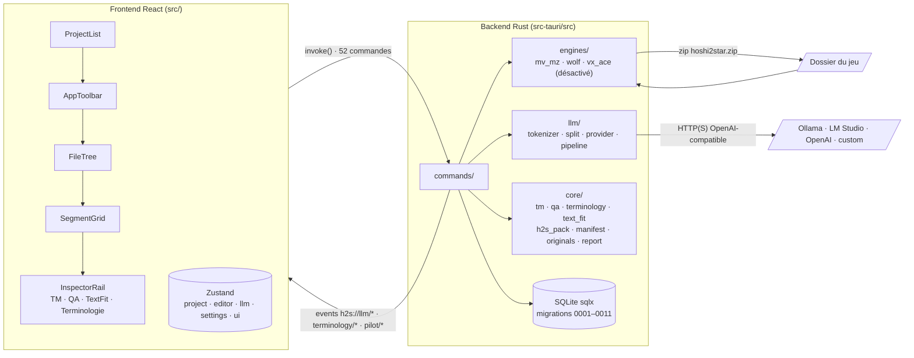

# Analyse complète de Hoshi2Star — rapport

**Plan :** `docs/plans/2026-10-25-analyse-complete-app.md`.
**Base analysée :** `main` @ `340e636` (v0.4.10), Rust ~47 k lignes (`src-tauri/src`), TS ~17 k lignes (`src/`).

| Session | Date | Outil | Sections |
|---|---|---|---|
| 1 — carte et contrôles automatiques | 2026-10-25 | Claude | Architecture, Menaces, Constats statiques, À confirmer sur jeux réels |
| 2 — parcours réels sur jeux (MV/MZ ; Wolf reporté) | 2026-10-25 | Claude | Parcours réels |
| 3 — vérifications ciblées et rapport final | 2026-10-25 | Claude | Synthèse, Vérifications ciblées, Liste priorisée, Ce qu'on ne fait pas, Lots proposés |

## Lecture du rapport

**Statut de chaque constat :**
- **vérifié-exéc.** : prouvé par une commande exécutée pendant la session (sortie d'outil).
- **vérifié-code** : le code lu suffit à prouver le mécanisme. L'effet réel n'a pas été déclenché. Les constats marqués « relu » ont été relus à la main par la session principale, en plus du sous-agent qui les a trouvés.
- **déduit** : raisonnement sur le code, sans preuve complète.
- **inconnu** : non déterminé.

**Gravité :**
- **bloquant** : corruption du jeu ou perte de traduction probable en usage normal.
- **majeur** : corruption, perte ou plantage atteignable avec une entrée réaliste ou forgée.
- **mineur** : défaut limité ou contourné.
- **info** : à savoir, pas à corriger en priorité.

**Méthode de la session 1 :**
- Cinq sous-agents en lecture seule, un par couche : engines, export, llm, core/commandes/base, UI.
- Relecture manuelle des constats majeurs.
- Contrôles automatiques, résultats bruts résumés dans la section « Constats statiques ».

Aucun code applicatif n'a été modifié et aucun jeu réel n'a été ouvert.
Sorties brutes des outils : `docs/audit/2026-10-analyse-complete.preuves.txt`.

---

## Synthèse

**État au 2026-10-25** (`main` @ `e537f67`, v0.4.10), après trois sessions : carte et contrôles automatiques, parcours réels sur 3 jeux MV/MZ, vérifications ciblées et relecture indépendante. Wolf n'a pas été testé sur jeu réel.

**Ce qui marche, prouvé sur jeux réels.**
- Aller-retour MV/MZ fidèle : 36 352 pointeurs justes sur 36 352, aucune autre valeur modifiée (P-1).
- Échantillons traduits, exportés et joués dans le navigateur intégré sans erreur (MV et 2 jeux MZ).
- Plusieurs points de l'audit du 05/09 sont corrigés ou en partie : `%n` des messages système et plugins, `displayName` et listes System (catégories optionnelles), limite SQL à 33 000 segments.

**Ce qui empêche une release sûre.**
1. **S-X1 (bloquant).** Après une mise à jour du jeu, l'export écrit les traductions sur d'autres lignes, sans message. En MV, une traduction devient un nom de fichier de visage et **la partie se bloque au premier événement** (vérifié en jeu). La relecture a trouvé pire : la reconstruction du snapshot peut remettre du japonais dans des champs non textuels, sans le signaler.
2. **S-L2 (majeur, priorité 1).** Une panne du fournisseur transforme tous les segments restants en « à réviser » avec la source comme cible, sans message d'erreur. Un toast par segment a fait tomber la webview (8,7 Go). « Tout traduire » ne reprend rien. Pendant une retraduction par sélection, la panne écraserait des traductions existantes (déduit du code).

**Ce qui gêne le travail au quotidien.** Export partiel refusé par l'interface (sportsfan30), app bloquée par « Traduire » sans fichier, mauvais projet traduit après un changement de projet, saisie perdue, jeu copié qui rouvre l'original, répliques voisines recopiées dans les cibles et pas toujours détectées, QA aux filtres trompeurs qui bloque des traductions justes.

**Les 4 retours de sportsfan30.** Trois confirmés (export partiel, recherche, text fitting MZ seulement). Le quatrième (QA) est confirmé en partie : le score est bien calculé en continu, ce sont les filtres et l'absence de type d'erreur qui gênent.

**Recommandation.** Avant toute fonctionnalité : R1 (panne du fournisseur, une seule notification), R2 (export sûr après mise à jour), R3 (dépendances, petit), puis R4 et R5 (export partiel, éditeur fiable). Ces cinq lots couvrent les deux blocages et les gênes les plus visibles. Effort estimé : 5 à 8 jours, plan détaillé par lot avant le code.

**Incertitudes.** Wolf non testé. Comportement exact sous NW.js non vérifié (navigateur intégré seulement). Base et jeu de sportsfan30 non disponibles. Efforts déduits, pas mesurés.

---

## Architecture

### Vue d'ensemble

### Couches

| Couche | Modules et entrées principales | Rôle |
|---|---|---|
| Commandes | `lib.rs:67`, un seul `generate_handler!` de 52 commandes. Projet, recherche, QA/TM, terminologie (15), couverture, text-fit, export, packs, pilote, traduction. Elles sont toutes appelables depuis la fenêtre `main` (pas de manifeste d'app restreint). | Frontière IPC |
| Engines MV/MZ | `mv_mz/extractor.rs` (un extracteur par type de fichier), `json_span.rs` (parseur JSON maison qui garde les octets, profondeur ≤ 128), `plugins_js.rs`, `keke.rs`, `coverage/`, `layout/` (géométrie `System.json`, polices WOFF/TTF), `profiles.rs` (TOML embarqués) | Extraction JSON → `Segment` |
| Engines Wolf | `wolf/decrypt/legacy_xor.rs` (DXA v5/v6/v8 : XOR, Huffman, LZ), `dat_parser.rs` (`.project`/`.dat`, LZ4 si 0xC4), `v3_format/` (`.mps`/`CommonEvent.dat` v3 maison, d'après WolfTL), `extractor.rs` (crate `wolfrpg-map-parser` forkée pour la v2, sous `catch_unwind`) | Extraction binaire → `Segment` |
| Engines VX Ace | `vx_ace/` via `marshal-rs`. Détection commentée (`detector.rs:143`). | Inactif |
| LLM | Une seule passe, la traduction (`pipeline.rs:1`). Un seul fournisseur, `OpenAiCompatibleProvider` (`provider.rs:194`), avec des préréglages ollama, lmstudio, huggingface, openai, custom. DeepL et DeepSeek n'existent pas en tant que fournisseurs dédiés. | Traduction automatique |
| Core | `tm.rs` (TM globale : SHA-256 de `trim+lowercase`, floue par Levenshtein en mémoire), `qa.rs` (contrôles structurels et sémantiques), `terminology/`, `text_fit.rs`, `h2s_pack.rs`, `manifest.rs`, `originals.rs` (snapshot MV/MZ vérifié par sha256), `report.rs` | Métier |
| Base | SQLite, 5 connexions, `foreign_keys(true)`, `journal_mode` non fixé (DELETE par défaut). Tables `projects` → `source_files` → `segments` (CASCADE), `tm_entries` (UNIQUE `source_hash, lang_pair`), terminologie (0008/0009), catégories (0010), text-fit (0011). | Persistance |
| UI | Routage par `ui.mode` : library, patch, terminology, player et images (ces deux derniers à venir). Stores `project`, `editor`, `llm`, `settings`, `ui`, `search`, `coverage`, `textFit`, `pilot`, `updater`. TanStack Query pour TM, QA, terminologie et polices. | Éditeur CAT |

### Flux principaux

1. **Ouvrir/extraire.** `open_project` (`commands/project.rs:52`) lit `.hoshi2star.json`, sinon crée un projet. L'extraction tourne dans `spawn_blocking` (:158), puis tout est inséré en une seule transaction, et le manifeste est écrit dans le dossier du jeu.
2. **Traduire.** `translate_segments` / `translate_all_segments` (`commands/translate.rs:24`, `:162`) lancent `tokio::spawn`, sans handle conservé. Ensuite :
   - réutilisation canonique, puis TM exacte ;
   - tokenisation `⟦ph_N⟧` (numérotée par segment) ;
   - paquets par classe ;
   - `llm_translate_with_split` : 3 essais, puis découpage récursif ;
   - analyse stricte de la réponse ;
   - `restore`, puis QA, avec au plus 2 relances sémantiques ;
   - `persist_batch_results` en une transaction.
3. **QA.** `check_segment` (structure) et `check_with_context` (sémantique). L'export appelle `audit_project` : un segment critique bloque l'export.
4. **Exporter.** `export_project` (`commands/export.rs:272`) écrit un zip `<jeu>/hoshi2star.zip` :
   - MV/MZ : injection dans le snapshot vierge, puis contrôle d'intégrité des valeurs ;
   - Wolf et VX Ace : injection à partir des fichiers **présents dans le dossier du jeu** ;
   - le joueur dézippe lui-même par-dessus le jeu. Aucune commande de restauration.
5. **Packs .h2s.** Lecture du zip en mémoire, puis écriture en base seulement, après un pack de sauvegarde.

### Zones les plus corrigées (historique Git)

Sur 320 commits, 36 sont des `fix`. Fichiers les plus touchés par ces correctifs :
- `commands/project.rs` (8), `commands/export.rs` (6), `SegmentGrid.tsx` (6) ;
- `wolf/dat_parser.rs` (5), `types.ts` (5) ;
- `tokenizer.rs`, `pipeline.rs`, `lib.rs`, `report.rs`, `qa.rs` (4 chacun).

Plusieurs constats ci-dessous tombent dans ces mêmes fichiers.

---

## Menaces

### Actifs à protéger, par ordre d'impact

1. **Fichiers du jeu** après application du zip : un jeu corrompu ou un texte écrit au mauvais endroit.
2. **Traductions** en base (travail humain et coût LLM).
3. **Poste de l'utilisateur** : lecture ou écriture de fichiers hors du jeu, plantage, gel.
4. **Clé API** du fournisseur LLM.

### Entrées non fiables et frontières

| Entrée | Qui la contrôle | Où elle est lue | Protections constatées | Risques résiduels |
|---|---|---|---|---|
| JSON MV/MZ (`data/*.json`) | Auteur du jeu, ou un tiers pour un jeu téléchargé | `serde_json`, extracteurs | Limite de récursion de serde | BOM non géré (S-E10) |
| `plugins.js` | Idem | `json_span` | Profondeur 128, noms de plugins assainis (`coverage.rs:305`) | Première affectation prise même dans un commentaire (info) |
| `System.json` → police | Idem | `text_fit.rs:141`, `geometry.rs:101` | **Aucune** sur le chemin | Lecture hors du jeu, `/dev/zero` (S-E3) |
| Police WOFF/TTF | Idem | `layout/font.rs` | Plafond 64 Mio, bombe zlib bornée | Boucle sans fin (S-E4) |
| Archives `.wolf` DXA v5/v6/v8 | Idem | `legacy_xor.rs` | Offsets en `checked_add`, sorties ≤ 1 Gio | Cycle de répertoires (S-E1), amplification (S-E5) |
| `.dat` / `.project` Wolf | Idem | `dat_parser.rs` | `read_bytes` borné, `bounded_cap` | `data_count` sans consommation (S-E6), LZ4 sans plafond (S-E7) |
| `.mps` / `CommonEvent.dat` v3 | Idem | `v3_format/` | `ByteReader::take` vérifié | `with_capacity(u32 lu)` qui fait avorter (S-E2) |
| `.mps` v2 | Idem | crate forkée | `catch_unwind` | Boucles et allocations non auditées (inconnu) |
| Ruby Marshal (VX Ace) | Idem | `marshal-rs` | aucune | Inactif ; à traiter avant réactivation (S-E9) |
| Pack `.h2s` reçu d'autrui | Un autre traducteur | `h2s_pack.rs:191` | Lu en mémoire (pas de zip slip), noms d'entrée fixes, 256 Mo par entrée, écrit seulement sur des `(fichier, clé)` existants | Pas d'atteinte au disque. Cibles importées → barrière QA de l'export. |
| `.hoshi2star.json` | Le dossier du jeu | `project.rs:60` | UUID validé avant usage comme chemin | `game_path` non comparé (S-C4) |
| Réponse du LLM | Le fournisseur, le modèle (ou le texte du jeu, par injection de prompt) | `provider.rs:713`, `:775` | Analyse stricte des ids, placeholders manquants ou dupliqués rejetés | Tokens étrangers, troncature, codes ajoutés (S-L1, S-L5, S-L7) |
| Appels IPC | La webview | 52 commandes | Requêtes SQL toutes paramétrées | Avec `csp: null` + `withGlobalTauri`, un XSS donnerait l'écriture de fichiers arbitraires via `export_tm`, `debug_*` (S-C3) |
| Réseau | Le fournisseur ou un intermédiaire | `reqwest` + rustls | TLS rustls, clé en en-tête Bearer, jamais persistée ni loggée | Avis RustSec rustls/webpki (S-D2) ; `http://` accepté vers un hôte distant (mineur) |
| Mises à jour | Releases GitHub | `tauri-plugin-updater` | Signature minisign, point d'accès HTTPS | — |

### Ce qui est hors du modèle

- Un attaquant qui contrôle déjà le compte de l'utilisateur.
- Les jeux eux-mêmes une fois lancés : Hoshi2Star ne les exécute pas.
- Le MCP bridge : `init()` seulement sous `cfg(debug_assertions)` (`lib.rs:122`). La permission reste dans `capabilities/default.json` en release, sans effet puisque le plugin n'y est pas chargé.

### Scénarios les plus crédibles

1. **Jeu mis à jour entre extraction et export** : traductions écrites sur d'autres lignes, sans erreur (S-X1, S-X4). C'est le risque n° 1 pour l'utilisateur, sans attaquant.
2. **Fournisseur LLM en panne pendant « Tout traduire »** : projet entier passé en `needs_review`, avec la source comme cible (S-L2).
3. **Jeu téléchargé piégé ou corrompu** : gel ou arrêt brutal de l'app (S-E1 à S-E7). Pas d'exécution de code identifiée.
4. **Fuite de fichier local** : un jeu piégé désigne une police hors du dossier (S-E3). Les octets ne remontent que si le fichier se lit comme une police.

---

## Constats statiques

### Contrôles automatiques

| Contrôle | Commande | Résultat | Statut |
|---|---|---|---|
| Tests frontend | `pnpm test` | 34 fichiers, 121 tests verts | vérifié-exéc. |
| Tests Rust + couverture | `cargo llvm-cov --summary-only` (LLVM système 23.1.3 = LLVM de rustc) | 691 verts, 12 ignorés ; 85,4 % des lignes | vérifié-exéc. |
| Clippy pedantic | `cargo clippy --all-targets -- -W clippy::pedantic` | Sortie 0 ; 961 avertissements, dont 759 uniques sur la lib (hors tests) | vérifié-exéc. |
| cargo audit | `cargo audit` (base RustSec du 2026-10-25) | 22 vulnérabilités, 10 avertissements | vérifié-exéc. |
| cargo deny | `cargo deny --config <scratchpad>/deny.toml check licenses sources bans` (config hors dépôt, cibles Linux + Windows) | bans ok (36 doublons en warn) ; licenses et sources en échec, voir S-D4 et S-D5 | vérifié-exéc. |
| pnpm audit | `pnpm audit` / `pnpm audit --prod` | 98 avis (1 critique, 34 hauts), dont 77 en `--prod` | vérifié-exéc. |
| Couverture TS | `@vitest/coverage-v8` | **non exécuté** : dépendance absente. Son ajout modifierait `package.json`, l'utilisateur ne l'a pas autorisé (seuls les outils cargo ont été installés). | — |
| security-review | skill `security-review`, appliqué à tout `main` faute de diff | aucune vulnérabilité retenue au seuil de 80 % | vérifié-code |

**Clippy pedantic, lints de la lib par fréquence :**
- `must_use_candidate` 157, `missing_errors_doc` 152, `doc_markdown` 96 ;
- `cast_possible_truncation` 96, `cast_sign_loss` 31, `cast_possible_wrap` 14 ;
- `too_many_lines` 29, `manual_let_else` 28, `map_unwrap_or` 23, `cast_lossless` 22, `implicit_hasher` 14, `cast_precision_loss` 11.

La majorité relève du style. Les lints qui touchent la correction :
- **conversions** dans les parseurs et écrivains binaires (`legacy_xor.rs`, `v3_format/*`, `wolf/injector.rs`, `layout/font.rs`). Les plus utiles sont repris en S-E4 et S-E8 ;
- `unchecked_time_subtraction` (`core/terminology/scanner.rs:209`, `Instant::now() - PROGRESS_INTERVAL`) : panique seulement si l'horloge monotone est plus jeune que l'intervalle. Info ;
- `float_cmp` (`layout/simulate.rs:101`) : info.

### Couverture

Mesure vérifiée par exécution le 2026-10-25 avec `cargo llvm-cov --summary-only`.

**Tests**
- 691 tests verts, 0 échec, 12 ignorés : 8 tests d'intégration et 4 de la lib.
- Les ignorés sont des tests sur jeux réels qui attendent des variables d'environnement. Ils n'ont pas été lancés.

**Total**

| Mesure | Couverture |
|---|---|
| Lignes | 85,4 % (32 141 lignes, dont 4 691 non couvertes) |
| Régions | 85,0 % |
| Fonctions | 80,1 % |

**Par module**

| Module | Lignes | Couverture |
|---|---|---|
| `commands/translate.rs` | 252 | **0 %** |
| `commands/export.rs` | 1 111 | **53,2 %** |
| `commands/terminology.rs` | 475 | 55,4 % |
| `engines/wolf/extractor.rs` | 1 134 | 58,6 % |
| `engines/wolf/decrypt/legacy_xor.rs` | 1 461 | 62,6 % |
| `engines/detector.rs` | 385 | 72,7 % |
| `commands/pack.rs` | 894 | 74,9 % |
| `llm/split.rs` | 162 | 76,5 % |
| `engines/wolf/injector.rs` | 1 097 | 79,9 % |
| `engines/mv_mz/integrity.rs` | 387 | 84,5 % |
| `engines/mv_mz` (ensemble) | 8 418 | 93,0 % |
| `llm/pipeline.rs` | 1 480 | 92,7 % |
| `llm/tokenizer.rs` | 489 | 98,6 % |
| `core/tm.rs` | 483 | 100 % |

**Lecture**
- Les zones de corruption les plus probables sont les moins couvertes :
  - l'export (`export.rs` 53 %, `wolf/injector.rs` 80 %) ;
  - l'extraction et l'injection Wolf (59 à 63 %) ;
  - la commande de traduction, qui n'est pas couverte du tout. Elle contient S-L2, S-L3, S-L4 et S-U1.
- Ces chiffres recoupent l'historique Git : `export.rs` et `project.rs` sont parmi les fichiers les plus corrigés.

**Non mesuré**
- La couverture TypeScript n'a pas été mesurée.

### Dépendances

**S-D1 — `zip` 2.4.2 : RUSTSEC-2026-0367, -0368, -0369 (SUID, liens symboliques, permissions à l'extraction).**
- Gravité : info. Statut : vérifié-code.
- Seul `ZipArchive::new` + lecture d'entrées est utilisé (`h2s_pack.rs:191`, `:224`). Jamais `extract()`, qui porte les failles.
- Correctif : `zip` ≥ 9 (rupture d'API). À planifier, sans urgence.

**S-D2 — `rustls` 0.23.40, `rustls-webpki` 0.103.13, `webpki-roots` 1.0.4 : 7 avis.**
- RUSTSEC-2026-0285 (messages de handshake acceptés entre niveaux de chiffrement), -0349 (rétrogradation de connexions ultérieures), -0382 (intermédiaires révoqués acceptés), -0381 et -0383 (racines emSign révoquées), -0346, -0348.
- Gravité : **majeur**. Statut : vérifié-exéc. (avis) / déduit (exploitation).
- Ces crates portent tout le TLS de l'app : fournisseurs LLM (clé API) et updater.
- Correctifs semver-compatibles : `cargo update -p rustls -p rustls-webpki -p webpki-roots -p webpki-root-certs`.

**S-D3 — Avis hors du chemin d'exécution.**
- `quinn-proto` (6 avis) et `rsa` (Marvin) : absents de l'arbre normal compilé (`cargo tree -e normal -i` vide).
- `quick-xml` 0.39.4 : présent seulement via `plist` → `tauri-utils`, à la compilation.
- Avertissements : `ttf-parser` non maintenu (utilisé par `layout/font.rs`) ; `glib`, `tokio`, `event-listener` unsound ; `spin` retiré (yanked).
- Gravité : info. Statut : vérifié-exéc.

**S-D4 — Licences.**
- La crate `hoshi2star` n'a pas de champ `license` dans `src-tauri/Cargo.toml`, alors qu'un `LICENSE` existe à la racine.
- `marshal-rs` 2.0.1 est sous WTFPL (permissive, mais rarement acceptée par les politiques de licence).
- Gravité : mineur. Statut : vérifié-exéc.

**S-D5 — Sources.**
- `wolfrpg-map-parser` vient d'une branche git du fork (`Cargo.toml:62`, `branch = "fix/wolf-v3-format"`), pas d'un commit fixé dans le manifeste. Seul `Cargo.lock` le fixe.
- Gravité : mineur. Statut : vérifié-exéc.

**S-D6 — npm.**
- Les 77 avis `--prod` passent tous par `shadcn` (la CLI, placée en `dependencies` alors qu'on n'importe que `shadcn/tailwind.css` dans `src/index.css:3`) ou par `@tailwindcss/vite` (outil de build).
- Les paquets concernés (hono, express/body-parser, proxy-addr critique, `@modelcontextprotocol/sdk`…) servent le serveur MCP de la CLI shadcn et ne sont pas embarqués dans le bundle.
- Côté dev : `vite`, `vitest`, `undici`, `postcss`.
- Gravité : mineur (outillage du poste de dev). Statut : vérifié-exéc. (avis) / déduit (absence du bundle, à confirmer par analyse de `dist/`).

### Engines (lecture des jeux)

**S-E1 — Boucle sans fin et OOM sur cycle de répertoires DXA v8.**
- Où : `wolf/decrypt/legacy_xor.rs:1077` (`build_per_file_key_str`) et `:1106` (`build_file_path`).
- Gravité : **majeur**. Statut : vérifié-code (relu).
- Les deux fonctions remontent `parent_dir_address / 32` tant que la valeur n'est pas `u64::MAX`, sans ensemble de visités ni profondeur maximale. Un répertoire parent de lui-même fait boucler, et `ks` / `components` grossissent jusqu'à l'OOM.
- Reproduction : test unitaire, TOC v8 en clair avec `dirs[1].parent_dir_address = 32`, sous timeout.

**S-E2 — Arrêt brutal du processus sur compteur v3 forgé.**
- Où : `wolf/v3_format/common_events.rs:133`, `:153`, `:159`, `:165`, `:176`, `:372` ; `map.rs:87`, `:93` ; `command.rs:133`.
- Gravité : **majeur**. Statut : vérifié-code / déduit (avortement).
- `Vec::with_capacity(count)` avec un `u32` lu tel quel. Un échec d'allocation fait avorter tout le processus, ni `catch_unwind` ni `spawn_blocking` ne le rattrapent.
- Reproduction : `CommonEvent.dat` v3.5 valide dont le payload LZ4 annonce `event_count = 0xFFFFFFFF`. `CommonEventsV3::parse` doit renvoyer `Err`.

**S-E3 — Chemin de police non assaini.**
- Où : `commands/text_fit.rs:141-144`, `layout/geometry.rs:101-105`, `get_game_font` (`text_fit.rs:694`).
- Gravité : **majeur**, pour le gel/OOM via `/dev/zero`. Le volet fuite de fichier n'est que du durcissement : la security-review le juge non exploitable (fichier lisible comme police seulement, octets gardés dans la webview). Statut : vérifié-code (relu).
- `game.join("fonts").join(name)`, où `name` vient de `System.json` (`advanced.mainFontFilename`). Un chemin absolu remplace la base, `..` est accepté.
- `"/dev/zero"` fait lire sans fin. Un fichier hors du jeu qui se lit comme une police est renvoyé au webview.
- Reproduction : `System.json` MZ avec `"mainFontFilename":"/dev/zero"`, puis `get_text_fit`.
- Le nom de plugin, lui, est bien assaini (`coverage.rs:305`) : reprendre la même règle.

**S-E4 — Boucle sans fin dans `build_sfnt`.**
- Où : `layout/font.rs:262` et `:267`.
- Gravité : **majeur**. Statut : vérifié-code (relu).
- `search_range * 2` en `u16` : à partir de 32 768 tables, le calcul déborde. En release il revient à 0 et `while 0 <= count` boucle sans fin, en gardant le mutex `FontCache`. En debug, c'est une panique. `count * 16` déborde aussi.
- Reproduction : WOFF avec 32 768 entrées de table nulles, puis `GameFont::from_bytes`.

**S-E5 — Amplification mémoire DXA.**
- Où : `legacy_xor.rs:589`, `:748`, `:799`, `:1440` et suivantes.
- Gravité : majeur. Statut : vérifié-code / déduit (OOM).
- v5/v6 : jusqu'à environ 262 000 entrées peuvent copier la même zone. v8 : Huffman et LZ remplissent jusqu'à 1 Gio par entrée. Tout est gardé dans `WolfArchive.files`, et l'archive est redécryptée à chaque `load_*_for_stem`.
- Reproduction : archive v6 forgée avec N entrées `data_offset=0, unpacked_size=len`, puis mesurer la mémoire de `extract_all`.

**S-E6 — `.dat` sans champ et `data_count = u32::MAX`.**
- Où : `wolf/dat_parser.rs:351`.
- Gravité : majeur. Statut : vérifié-code.
- Chaque entrée consomme 0 octet : 4×10⁹ `DatEntry` avec `format!`, donc une boucle CPU puis l'OOM.
- Reproduction : `.dat` minimal, un type, `fields_size = 0`, `data_count = u32::MAX`, puis `parse_database` sous timeout.

**S-E7 — LZ4 sans plafond de sortie.**
- Où : `dat_parser.rs:467`, `v3_format/compression.rs:81`.
- Gravité : mineur à majeur. Statut : déduit.
- `lz4_flex::decompress(.., dec_size ≤ 4 Gio)` alloue d'emblée. Sous Windows, la limite d'engagement mémoire peut faire avorter. Il manque un plafond du type `MAX_DECODE_OUTPUT`.
- Reproduction : bloc LZ4 de quelques octets annonçant `dec_size = 0xFFFFFFFF`, sous Windows.

**S-E8 — Addition non contrôlée.**
- Où : `legacy_xor.rs:1110`.
- Gravité : mineur. Statut : vérifié-code (relu).
- `ft_offset + dir.dir_address as usize`, alors que le code jumeau en `:1078` utilise `saturating_add`. Panique en debug.
- Reproduction : `dir_address = u64::MAX` dans un TOC v8, puis build debug.

**S-E9 — VX Ace : `marshal_rs::load_utf8` sans `catch_unwind`.**
- Où : `vx_ace/extractor.rs:79`.
- Gravité : majeur (inactif). Statut : vérifié-code.
- La crate fait des `unwrap`, des `with_capacity` lus dans le fichier et une récursion non bornée. Prérequis avant de réactiver `detector.rs:143`.
- Reproduction : fichier `.rvdata2` tronqué ou à taille de tableau énorme, puis `extract_from_bytes`.

**S-E10 — BOM UTF-8.**
- Où : `detector.rs:124`, `commands/project.rs` (`serde_json::from_str`).
- Gravité : mineur. Statut : déduit.
- Un `System.json` avec BOM n'est pas reconnu comme MV/MZ. Les autres JSON avec BOM sont ignorés avec un avertissement.
- Reproduction : préfixer `System.json` d'une fixture MV par `EF BB BF`, puis `detect_engine`.

**S-E11 — Remappage D2/D3 sur tout le fichier.**
- Où : `wolf/extractor.rs:26-50`.
- Gravité : mineur. Statut : déduit.
- `normalize_wolf_command_signatures` remplace tout motif `XX D2 00 00` / `XX D3 00 00`, y compris dans des arguments entiers.
- Reproduction : à écrire (`.mps` v2 forgé avec un argument entier valant `0x0000D2xx`).

**S-E12 — Couverture de tests sur entrées forgées.**
- Statut : vérifié-code (inventaire).
- Il existe des tests adverses (tailles Huffman/LZ, offsets v8, `huge_tile_dims`, `type_count`).
- Rien sur S-E1, S-E2, S-E4, S-E6. Ni fuzzing ni proptest. Aucune fixture Wolf/DXA sur disque.

### Export (écriture et risque de corruption)

**S-X1 — Traductions écrites sur d'autres lignes après une mise à jour du jeu (MV/MZ).**
- Où : `mv_mz/integrity.rs:80-190`, `core/originals.rs` (`update_snapshot`), `commands/export.rs`.
- Gravité : **bloquant** (à confirmer en session 2). Statut : vérifié-code / impact déduit.
- `verify_json_edit` accepte n'importe quelle valeur d'origine sous un pointeur. `OriginalChanged` ne sert qu'à `plugins.js`.
- Le snapshot suit la nouvelle version du jeu et note la dérive (`drift`) dans un simple `log::warn`. L'export ne lit jamais `drift`.
- Une commande insérée par un patch décale les pointeurs JSON : les traductions atterrissent ailleurs, sans erreur.
- Reproduction : traduire, insérer un 401 avant une ligne traduite de `Map001.json`, exporter, comparer l'entrée du zip.

**S-X2 — Pertes silencieuses à l'injection Wolf v2.**
- Où : `wolf/injector.rs:245` (`splice_wolf_strings`) et `:731`, `:748`.
- Gravité : **majeur**. Statut : vérifié-code / déduit (faux appariement).
- Aucun contrôle `rep_idx == replacements.len()`. `updated_count` est ignoré. Un fichier introuvable donne un `continue`.
- L'encodage vient d'une estimation globale (`guess_wolf_version_from_structure`) : si elle se trompe, aucune trame ne correspond et toutes les traductions disparaissent sans erreur.
- Une trame antérieure aux mêmes octets que la source peut recevoir la traduction, et donc altérer une chaîne non textuelle.
- Reproduction : `inject_map` sur un `.mps` Shift-JIS avec une version estimée UTF-8, asserter `updated_count == n` ; `.mps` forgé où un nom d'événement égale le texte d'un choix.

**S-X3 — `.dat` Wolf non conservé à l'identique.**
- Où : `wolf/injector.rs:408` (`serialize_dat_type`), `dat_parser.rs:317-322`.
- Gravité : majeur. Statut : vérifié-code / impact inconnu.
- `unknown1` est toujours écrit à 0, la chaîne `STRING_INDICATOR` est lue puis jetée, le magic et le terminateur sont régénérés.
- Seul un test synthétique existe. Prouver `inject_dat(&[]) == original` sur des `.dat` réels.

**S-X4 — Wolf et VX Ace injectent à partir du dossier du jeu, sans comparer `source_text`.**
- Où : `commands/export.rs:422` (VX Ace), `:922` (`collect_wolf_zip_entries`), `wolf/injector.rs:363`.
- Gravité : majeur. Statut : vérifié-code.
- Même risque que S-X1, sans aucune détection. Pas de snapshot des originaux (`core/originals.rs:5`).
- Reproduction : projet Wolf, traduire, modifier un `.mps` du jeu (texte inséré avant une ligne traduite), exporter, comparer.

**S-X5 — `debug_inject_file` écrase les fichiers du jeu en place.**
- Où : `commands/export.rs:1052`.
- Gravité : majeur (exposition réduite). Statut : vérifié-code.
- `fs::write` non atomique (`:1172`, `:1209`, `:1232`, `wolf/injector.rs:795`, `:810`, `:821`). Aucune sauvegarde pour Wolf et VX Ace.
- Aucun écran ne l'appelle, mais la commande est enregistrée en release (`lib.rs:95`), comme `debug_dump_segments` et `export_debug_json`.
- Reproduction : `invoke('debug_inject_file', …)` depuis les devtools en dev, sur une copie de jeu Wolf.

**S-X6 — Zip et pack non atomiques.**
- Où : `export.rs:971`, `h2s_pack.rs:151`.
- Gravité : mineur. Statut : vérifié-code.
- `File::create` tronque l'ancien fichier. Une erreur en cours d'écriture laisse un zip tronqué, sans toucher au jeu.
- Reproduction : exporter vers un disque presque plein (ou `ulimit -f`), vérifier l'ancien zip.

**S-X7 — L'export modifie la base.**
- Où : `strip_font_prefixes` (`export.rs:232`), `audit_project` (`report.rs:234-241`).
- Gravité : mineur. Statut : vérifié-code.
- `strip_font_prefixes` retire aussi les `\FS[n]` voulus par le traducteur, sans sauvegarde.
- `audit_project` remet `needs_review` en `translated` hors erreur critique, ce qui efface le marquage « source modifiée » posé par l'import .h2s.
- Reproduction : cible contenant `\FS[20]` voulu, lancer l'export avec retrait des préfixes, relire `target_text`.

**S-X8 — Annulation d'import .h2s incomplète.**
- Où : `commands/pack.rs:66` (`build_project_pack`), `:662` (`write_backup`).
- Gravité : mineur. Statut : vérifié-code.
- La sauvegarde n'exporte que les cibles non vides : un import en mode « fill » ne peut pas être annulé en réimportant la sauvegarde.
- Le nom de sauvegarde est à la seconde près : deux imports dans la même seconde écrasent la sauvegarde.
- Reproduction : import « fill » sur des segments vides, puis réimporter la sauvegarde : les segments restent remplis.

**S-X9 — Wolf : caractère non représentable en Shift-JIS.**
- Où : `wolf/injector.rs` (test `:936`).
- Gravité : mineur (échec sûr). Statut : vérifié-code.
- L'export échoue en entier, alors que la QA ne signale rien en amont. Un seul « é » bloque un jeu Wolf v2 traduit en français.
- Reproduction : test existant `injector.rs:936`, plus un essai d'export réel en session 2.

**S-X10 — Fidélité de format MV/MZ.**
- Gravité : info. Statut : vérifié-code.
- Les fichiers `data/*.json` sont re-sérialisés par serde_json (`preserve_order`, `float_roundtrip`) : l'ordre des clés et les nombres sont conservés, mais pas la mise en forme ni les `\uXXXX`.
- `plugins.js` est édité par spans, avec un test d'identité octet pour octet (`plugins_js.rs:261`).

### LLM

**S-L1 — Token inventé ou venu d'un autre segment accepté.**
- Où : `llm/tokenizer.rs:244-263`, `core/qa.rs:400-414`.
- Gravité : **majeur**. Statut : vérifié-code (relu).
- `validate` ne parcourt que les clés de la table du segment, et la numérotation repart à 0 par segment. Un `⟦ph_0⟧` déplacé ou inventé reste en clair dans la cible enregistrée `translated`.
- Reproduction : MockProvider qui renvoie `"Hello ⟦ph_0⟧"` pour une source sans placeholder.

**S-L2 — Panne du fournisseur transformée en `needs_review` massif et silencieux.**
- Où : `provider.rs:447-460`, `split.rs:156-162`, `pipeline.rs:579-585`.
- Gravité : **majeur**. Statut : vérifié-code.
- 3 relances immédiates, même sur un 401. Ensuite tout le paquet passe en `needs_review`, avec la source comme cible, et l'exécution se termine par `completed`.
- Ces segments ne sont plus repris par « Tout traduire » (`translate.rs:243`).
- Reproduction : httpmock qui renvoie 500 ou 429.

**S-L3 — Une retraduction peut écraser une traduction humaine.**
- Où : `translate.rs:36`, `pipeline.rs:153-158`.
- Gravité : majeur. Statut : vérifié-code.
- Les ids explicites sélectionnent tous les statuts. L'UPDATE n'a aucune condition de statut ni de date : un segment `reviewed`, ou édité pendant le paquet, est écrasé, y compris par la source en cas d'échec (S-L2).
- Reproduction : MockProvider qui passe le segment en `reviewed` en base pendant l'appel, puis vérifier qu'il est écrasé.

**S-L4 — Pas d'annulation, verrou de concurrence seulement côté UI.**
- Où : `translate.rs:68`, `:204`, `stores/llm.ts:185`.
- Gravité : majeur. Statut : vérifié-code.
- Recharger la webview permet une seconde exécution parallèle. Il est impossible d'arrêter une traduction en cours.
- Reproduction : lancer « Tout traduire », recharger la webview (Ctrl+R), relancer, puis compter les appels au fournisseur.

**S-L5 — Réponse tronquée acceptée en protocole par lignes.**
- Où : `provider.rs:349-357`.
- Gravité : majeur. Statut : vérifié-code.
- `finish_reason` n'est pas lu : avec `length`, une dernière ligne coupée est acceptée. Tous les préréglages sauf ollama sont concernés.
- Reproduction : httpmock qui renvoie `finish_reason:"length"` et une dernière ligne `[20] Hello, I am go`.

**S-L6 — Dédup et TM confondent des textes différents.**
- Où : `core/tm.rs:44-48`.
- Gravité : mineur. Statut : vérifié-code.
- Le hachage de `trim().to_lowercase()` fait partager la même traduction à `"HP"`/`"hp"` et à `"　はい"`/`"はい"`.
- Reproduction : test `tm.rs` qui insère `HP` puis cherche `hp`.

**S-L7 — Codes d'échappement ajoutés et lignes en trop acceptés.**
- Où : `qa.rs:317-318`, `:577`.
- Gravité : mineur. Statut : vérifié-code / effet en jeu inconnu.
- Aussi : placeholders en trop non comptés (`qa.rs:401-411`, présence seulement) et tokens réordonnés acceptés.
- Reproduction : source `\V[1]\V[1]`, cible `\V[1]` ; cible avec `\C[3]` ajouté. `check_segment` ne doit pas rester muet.

**S-L8 — Divers.**
- Gravité : mineur. Statut : vérifié-code.
- Réponse lue sans limite de taille (`.json()`, délai 180 s × 3).
- `translate_segments` applique le moteur et les langues du premier id à tous les ids (`translate.rs:92-112`).
- `ProviderConfig` dérive `Debug` (clé exposée par un futur `{:?}`).
- `http://` accepté vers un hôte distant.
- `.expect("reqwest client")` (`provider.rs:215`).
- Reproduction : à écrire, une par point (httpmock à gros corps, ids de deux projets).

### Core, commandes, base

**S-C1 — Index manquant sur `terminology_occurrences.segment_id`.**
- Où : migration 0008, `scanner.rs:485`, cascades de `delete_project` (`project.rs:530`).
- Gravité : majeur (perf. à l'échelle). Statut : vérifié-exéc. par un sous-agent (`EXPLAIN QUERY PLAN` → `SCAN`, sur une base temporaire créée depuis les migrations ; sortie non conservée) / ampleur déduite.
- Reproduction : `EXPLAIN QUERY PLAN DELETE FROM terminology_occurrences WHERE segment_id='x'`.

**S-C2 — TM floue : parcours complet et Levenshtein sur le runtime async.**
- Où : `core/tm.rs:158-200`, appelé par `get_tm_suggestions`.
- Gravité : majeur à l'échelle. Statut : vérifié-exéc. par un sous-agent (plan `SCAN tm_entries`, sortie non conservée) / latence déduite.
- Pas de `spawn_blocking` ni de pré-filtre de longueur. La TM est globale à tous les projets, donc grandit sans fin.
- Reproduction : insérer 100 000 entrées dans une base de test, chronométrer `get_tm_suggestions`.

**S-C3 — `csp: null` + `withGlobalTauri: true`.**
- Où : `tauri.conf.json:13`, `:23-24`.
- Gravité : majeur (défense en profondeur). Statut : vérifié-code (relu).
- Aucun `dangerouslySetInnerHTML` ni `innerHTML` trouvé. Si une faille XSS apparaissait, toutes les commandes (`export_tm` vers un chemin arbitraire, `debug_inject_file`, `delete_project`) seraient appelables.
- Reproduction : `window.__TAURI__.core.invoke('export_tm',{langPair:'ja-en',outputPath:'/tmp/x'})` depuis les devtools.

**S-C4 — Manifeste restauré sans comparer le chemin.**
- Où : `project.rs:60-90`.
- Gravité : majeur. Statut : déduit.
- Une copie du dossier d'un jeu déjà ouvert rouvre le projet d'origine : l'export et le snapshot visent l'ancien dossier.
- Reproduction : ouvrir A, `cp -r A B`, ouvrir B, comparer `game_path` à B.

**S-C5 — Projets en double si le manifeste ne peut pas être écrit.**
- Où : `project.rs:222`.
- Gravité : mineur (majeur pour les dossiers en lecture seule). Statut : vérifié-code.
- Pas de recherche par `game_path`, pas de contrainte UNIQUE.
- Reproduction : ouvrir deux fois un dossier en lecture seule, compter les lignes de `projects`.

**S-C6 — `update_segment` passe toujours le statut à `translated` et alimente la TM globale, même avec une erreur QA critique.**
- Où : `project.rs:388`, `:421`.
- Gravité : mineur. Statut : vérifié-code.
- Une paire défectueuse se propage aux autres projets via la TM.
- Reproduction : enregistrer une cible sans `\V[1]`, puis lire `segments.status` et `tm_entries`.

**S-C7 — Divers.**
- Gravité : mineur/info. Statut : vérifié-code / déduit pour le verrouillage.
- `get_segments` : `page_size` non borné (`LIMIT -1`) (`project.rs:311`).
- `journal_mode` non fixé : « database is locked » possible pendant un scan.
- Langue cible par défaut incohérente : `fr` dans le code, `en` dans la migration 0006.
- `delete_project` ne vérifie pas qu'un scan est en cours.
- Reproduction : `invoke('get_segments',{…,page:0,pageSize:-1})` ; ouvrir un gros jeu pendant un scan terminologique.

Pas d'injection SQL : toutes les requêtes sont liées par paramètres. Le `format!` de `search.rs:94`, `:105` n'insère qu'un prédicat statique. Vérifié-code.

### UI

**S-U1 — « Traduire » sans fichier sélectionné bloque l'app.**
- Où : `useAppHandlers.ts:202`, `commands/translate.rs:52-53`, `stores/llm.ts:235-249`.
- Gravité : **majeur**. Statut : vérifié-code (relu).
- Le backend renvoie `Ok(())` sans événement, et `isTranslating` reste vrai jusqu'au redémarrage.
- Reproduction (Vitest) : `translate_segments` qui résout, `activeFileId = null`, puis `handleTranslate`.

**S-U2 — L'état de l'éditeur survit au changement de projet.**
- Où : `stores/project.ts:110-118`, `:187-197`.
- Gravité : **majeur**. Statut : vérifié-code.
- `setActiveFile(null)` n'est jamais appelé. « Traduire » envoie alors le `fileId` du projet A pendant que B est ouvert, et la branche fichier du backend ne vérifie pas le projet.
- Reproduction : ouvrir A, choisir un fichier, ouvrir B, cliquer « Traduire », puis lire les segments de A en base.

**S-U3 — Saisie perdue au démontage de la cellule.**
- Où : `SegmentGrid.tsx:93`, `:269-276`, `:387-392`, `:404` ; `columns.tsx:100`.
- Gravité : majeur. Statut : déduit (dépend du blur WebKitGTK).
- La sauvegarde ne passe que par `onBlur`. Un rechargement sur `llm/completed` ou le défilement démonte la cellule. Aucune garde à la fermeture de la fenêtre.
- Reproduction : traduire une ligne, taper dans une autre cellule sans quitter le champ, attendre `llm/completed` (session 2).

**S-U4 — Course dans la liste des modèles.**
- Où : `SettingsModal.tsx:66-94`.
- Gravité : majeur (code vérifié, atteignabilité déduite).
- Une réponse lente de l'ancien fournisseur écrase `draft.ollamaModel`.
- Reproduction : Vitest, `get_provider_models` différé, changer de fournisseur, résoudre, vérifier le draft.

**S-U5 — Erreurs avalées ou non affichées.**
- Gravité : mineur. Statut : vérifié-code.
- `llm.ts:241-249` : `error` n'est lu par aucun composant.
- `useAppHandlers.ts:153-166` : try/finally sans catch.
- Aussi : `TextFitPreviewPanel.tsx:193-201`, `SettingsModal.tsx:131-134`, `App.tsx:64`, `updater.ts:81`.
- Et `columns.tsx:110-120` : `savedRef` est mis à jour avant le résultat, ce qui perd le texte après un rejet.
- Reproduction : Vitest, `update_segment` qui rejette, puis vérifier le texte de la cellule.

**S-U6 — Divers.**
- Gravité : mineur/info. Statut : vérifié-code.
- Clic sur une suggestion TM sans effet : `onApply` jamais passé (`InspectorRail.tsx:131`).
- Clé de requête QA sans `segmentId` (`QAPanel.tsx:204`).
- Ouvertures de projet concurrentes sans garde de séquence (`project.ts:99`).
- Chaînes FR codées en dur (`llm.ts:221`, …).
- Neuf sélecteurs morts.
- Composants de plus de 600 lignes (SegmentGrid, TextCoverageDialog, PilotComparisonWorkspace, TerminologyWorkspace).
- Reproduction : clic sur une suggestion TM dans l'app ; les autres points se constatent à la lecture.

Le texte du jeu et du LLM est rendu en nœuds texte React ; `openUrl` n'ouvre qu'une constante ; la clé API n'est jamais persistée. Vérifié-code.

### security-review (tout `main`)

Skill `security-review` appliqué à tout `main` par un sous-agent. La revue n'a été que lue, rien n'a été exécuté. Les DoS et les épuisements de ressources sont exclus par la méthode : ils sont traités dans S-E*.

**Aucune vulnérabilité retenue** avec une confiance supérieure à 80 % d'exploitation réelle.

| Piste | Conclusion | Preuve |
|---|---|---|
| Police hors du jeu (S-E3) | Durcissement, pas une faille exploitable. Le fichier doit se lire comme une police (`font.rs:184-185`, `text_fit.rs:703`), et les octets restent dans la webview. | `FontError::Io` révèle seulement si un fichier existe. |
| Rapport QA HTML | Échappement présent. | `escape_xml` (`utils/text.rs:3-8`) appliqué au titre, aux options, aux attributs, à la source, à la cible et aux libellés (`report.rs:570`, `:624`, `:711`, `:720`, `:730`, `:737`, `:752`). Attributs entre guillemets doubles. |
| XSS frontend | Aucun vecteur trouvé. | Pas de `dangerouslySetInnerHTML`, `innerHTML`, `insertAdjacentHTML`, `document.write`, `new Function`, `srcdoc` ni rendu markdown brut. |
| Écriture à un chemin arbitraire via IPC (`export_tm`, `debug_*`) | Exploitable seulement après une XSS. | Impact maximal à retenir pour S-C3. |
| Pack `.h2s` | Aucun nom d'entrée ne sert de chemin. | `h2s_pack.rs:189-250`. La sauvegarde a un nom fixe (`pack.rs:672-681`). |
| Zip d'export | Pas d'extraction, donc pas de zip slip. | Noms issus de `strip_prefix` ou fixes (`export.rs:970-982`). |
| Chemins tirés des archives Wolf | Jamais écrits tels quels : seul le `file_stem` est gardé. | `extractor.rs:246-250`, `:381`, `:421`, `:819`. Cas d'un `\` dans un nom sous Windows **inconnu**. |
| SQL, commandes système, TLS | Rien à signaler. | Requêtes liées par paramètres. Aucun `Command::new` hors tests. Aucun `danger_accept_invalid_certs`. |
| Updater | Signature minisign et point d'accès HTTPS. | `tauri.conf.json:43-50`. |
| Clé API | Aucun log ni message ne l'affiche. | Recherche dans `llm/` et `commands/`. |
| `mcp-bridge` | Pas chargé en release. | `lib.rs:122-124` (`cfg(debug_assertions)`). La permission reste dans les capabilities : la retirer du build release relève du rangement. |

---

## À confirmer sur jeux réels

À traiter en session 2. Chaque point renvoie à un constat ci-dessus.

**MV/MZ**
- [x] (session 2, voir P-1) Aller-retour sans traduction : comparer le zip au jeu, en distinguant les octets des valeurs (S-X10). Comparer les comptes : segments extraits = en base = modifiés dans le zip.
- [x] (session 2, P-2 : confirmé) Fausse mise à jour du jeu (événement inséré dans une carte traduite), puis export : où atterrissent les traductions (S-X1) ?
- [ ] (session 2 : non couvert, P-7) `plugins.js` réels : CRLF, BOM, `\u`, `\/`, doublons de clés. Vérifier l'identité octet pour octet après `apply_edits`.
- [x] (session 2, P-7) Fréquence des `System.json` avec BOM (S-E10). Valeurs réelles de `mainFontFilename` (S-E3).
- [x] (session 2, P-4 : confirmé pour `llm/completed` ; défilement et fermeture non testés) Saisie en cours pendant `llm/completed` et au défilement dans WebKitGTK (S-U3). Fermeture de la fenêtre avec une saisie non validée.
- [x] (session 2, P-3 : S-U1 et S-U2 confirmés) Bouton « Traduire » sans fichier sélectionné (S-U1) ; changement de projet puis « Traduire » (S-U2).

**Wolf v2 (Honoka) et v3 (Inko)**
- [ ] `inject_dat(&[])` octet pour octet sur des `.dat` réels ; présence de `unknown1 != 0` ou de `STRING_INDICATOR` (S-X3).
- [ ] Après export complet, ré-extraire : nombre de cibles appliquées = traduits en base (S-X2).
- [ ] Estimation d'encodage v2 juste sur chaque jeu (S-X2).
- [ ] `dump(parse(x)) == x` pour `MapV3` et `CommonEventsV3` sur plusieurs versions (0x65 à 0x67 et au-delà), trailer v3.5.
- [ ] DXA v8 réellement chiffrées (une seule chaîne de clé connue), `no_head_press`, noms en CP932/UTF-8 ; v5/v6 avec clé intégrée (v2.255).
- [ ] Le moteur lit-il les fichiers posés en clair dans `Data/` à côté de `Data.wolf` ?
- [ ] Effet du remappage D2/D3 sur les cartes v2 (S-E11).
- [ ] Traduction vers le français : caractère non Shift-JIS (S-X9).

**LLM (petit échantillon, modèle de test)**
- [x] (session 2, P-5 : S-L1 non observé ; S-L5 non couvert par le préréglage ollama) Fréquence des tokens déplacés entre segments (S-L1) et des troncatures `finish_reason=length` (S-L5), avec un modèle local de 4 à 8B.
- [x] (session 2, P-6 : confirmé, aggravé) Coupure du fournisseur pendant « Tout traduire » : statut des segments et message affiché (S-L2).
- [x] (session 2, P-5) Respect du schéma JSON strict par la version d'Ollama utilisée.

**Base réelle (copie seulement)**
- [ ] `PRAGMA journal_mode` ; volume de `tm_entries` par `lang_pair` (S-C2) ; nombre d'occurrences terminologiques et durée de `delete_project` (S-C1).
- [ ] Manifeste dans un dossier en lecture seule (Steam/Program Files) (S-C5).
- [ ] Lancer les 12 tests `#[ignore]` sur données réelles :
  - 8 d'intégration : `real_game_coverage` ×4, `standgirl_full_pilot` ×2, `terminology_real_pilot` ×2 ;
  - 4 dans la lib (à lister avec `cargo test -- --ignored --list`).

---

## Parcours réels

**Session 2 — 2026-10-25, Claude.** MV et MZ seulement. Wolf est reporté après la session REA (décision utilisateur). Aucun code applicatif n'a été modifié.

Preuves :
- Preuves brutes : `docs/audit/2026-10-analyse-complete.session2.preuves.txt`.
- Captures, JSON attendus et scripts : `test/_session2/` (ignoré par Git), avec les sous-dossiers `evidence/`, `tools/` et `zips/`.

### Mise en place

- **Jeux** : copies reflink btrfs des dossiers de `test/` vers `test/_session2/games/`. Les originaux n'ont jamais été ouverts dans l'app. Empreinte sha256 des `data/*.json`, de `plugins.js` et du manifeste relevée avant et après la session : identique (`00-originals-hash-before.txt` / `-after.txt`). La base originale est aussi inchangée en fin de session.
- **Base** : copie de tout `~/.local/share/com.blackat.hoshi2star/` (base, `settings.json`, stockage webview) vers `test/_session2/xdg-data/`.
  - L'app ouvre `app_data_dir()/hoshi2star.db` (`lib.rs:51`), c'est-à-dire `$XDG_DATA_HOME/com.blackat.hoshi2star` sous Linux.
  - Lancement : `env XDG_DATA_HOME=…/test/_session2/xdg-data pnpm tauri:linux`.
  - Preuves (`00-setup.txt`) : `/proc/<pid>/fd` ne montre que la copie ; le sha256 de la base originale (`fc698f5f…`) est inchangé.
- **Pilotage** :
  - MCP `tauri` sur l'app de dev ;
  - ouverture des jeux par le thunk réel `openProject()` de `stores/project.ts`, importé dans la webview, car le sélecteur de dossier natif n'est pas pilotable ;
  - grille, boutons et dialogues pilotés par clics et frappes ;
  - export par `export_project` quand l'interface refusait un export partiel.
- **Modèle** : Ollama 0.40.10, préréglage `ollama`. `gemma4:e4b` pour tous les essais, `gemma4:e2b` en comparaison sur l'échantillon MV. GPU GTX 1660 SUPER, 6 Go.
- **Correction de mise en place (StandGirl)** : la base copiée et le manifeste de la copie pointaient vers le dossier original. Ils ont été réécrits vers la copie, dans la base copiée seulement (voir P-8).
- **Méthode des comptes** : un export « sans traduction » donne un zip vide. Un export cible = source est refusé par la QA (`UnchangedSource` critique, `qa.rs:701`). On remplit donc **tous** les segments avec un marqueur déterministe :
  - `H<sha1 source>L<ligne>` suivi des codes de la source, avec les noms `\n<…>` neutralisés ;
  - même nombre de lignes, aucun japonais ;
  - script `tools/marker_targets.py`.
  On exporte, puis on contrôle chaque pointeur JSON contre la valeur attendue, et toutes les autres feuilles contre le jeu original (`tools/verify_markers.py`).

### Résultats par jeu

| Jeu | Projet | Segments extraits | Aller-retour par marqueurs | Échantillon e4b | Zip d'essai |
|---|---|---|---|---|---|
| MV (RJ432000) | neuf | 15 498 (159 fichiers) | 15 498/15 498 pointeurs justes, 0 autre valeur modifiée | 38 en base = 38 pointeurs justes = 38 feuilles modifiées | `zips/MV_sample_e4b.zip` |
| MZ StandGirl | ancien (29/08, v0.4.10) | 1 191 (26 fichiers), identique à une extraction neuve | 1 191/1 191, 0 autre | 31 = 31 = 31 | `zips/MZ_standgirl_sample_e4b.zip` |
| MZ 借金JK | neuf | 19 663 (20 fichiers) | 19 663/19 663, 0 autre | 34 = 34 = 34, en **français** (voir P-9) | `zips/MZ_shakkin_sample_e4b_fr.zip` |

### Constats

**P-1 — Aller-retour MV/MZ fidèle en valeurs (S-X10 confirmé, info).** Statut : vérifié-exéc.
- Sur les 3 jeux, aucune valeur JSON hors segments n'est modifiée.
- Seule la mise en forme change : l'éditeur écrit un retour à la ligne par élément (158 fichiers sur 159 en MV), le zip est compact.
- Aucun fichier sans segment n'est mis dans le zip.

**P-2 — S-X1 confirmé, plus grave que prévu (bloquant).** Statut : vérifié-exéc.
- MV, `Map001.json` de la copie : insertion d'un 401 en `/events/6/pages/0/list/2`, puis export par l'interface (« Tout exporter », police ignorée).
- L'export **réussit sans message**. Les 14 pointeurs de la page reçoivent leur traduction à l'ancien index :
  - 12 commandes **101** reçoivent une traduction dans `parameters[0]`, c'est-à-dire le **nom de fichier du visage** (exemple : `['H14c9eaL0\\n<Nce4f>', 0, 0, 2]`) ;
  - 13 lignes 401 restent en japonais ;
  - la ligne ajoutée reçoit la traduction de la ligne suivante.
- **En jeu, vérifié le 2026-10-25** dans le navigateur intégré (MV 1.6.1 servi en HTTP), avec le zip de reproduction ci-dessous :
  - nouvelle partie, carte de départ ; le jeu demande `img/faces/\n<Haruka>Let's go to school..rpgmvp` (404) ;
  - la fenêtre de message reste ouverte et **vide**, `ImageManager.isReady()` reste `false` ;
  - l'entrée OK est sans effet et aucun écran d'erreur n'apparaît : **la partie est bloquée dès le premier événement** ;
  - sous NW.js (Game.exe), le comportement exact reste à confirmer par l'utilisateur.
- Zip de reproduction pour l'essai en jeu : `zips/MV_SX1_repro_after_update.zip`. Map051, événement d'ouverture de la carte de départ : 401 ajouté avant le 101 ; la traduction se retrouve en `101.parameters[0]` = `"\\n<Haruka>Let's go to school."` (`mv-17`).
- Le snapshot note la dérive de 2 pointeurs seulement sur 14 (`snapshot.json`, `drift`). L'export ne la lit pas. Explication en session 3 (relecture) : la règle `stale_export` remet les autres à la source sans les compter.
- MZ (StandGirl), deux essais : l'issue dépend de la **structure de la page**, pas du moteur. L'export échoue dès qu'un pointeur décalé devient invalide, et réussit en silence sinon (comme en MV).
  - `Map001.json` : le décalage tombe sur un choix 102. L'export **échoue en entier** avec `key not found in JSON: /events/2/pages/0/list/6/parameters/0/0`.
  - `Map004.json`, page sans choix : le nom de locuteur MZ (`101.parameters[4]`) devient invalide quand un 401 glisse à sa place. L'export échoue avec `key not found in JSON: /events/2/pages/0/list/30/parameters/4`.
  - L'échec est un échec sûr, mais le message n'aide pas à agir.
  - En MZ, les noms de locuteur rendent l'échec bruyant probable. Une page sans nom ni choix se comporterait comme MV (déduit, non reproduit).
- Preuves : `mv-06`, `mv-09`, `mz1-07`, `mz3-01`.

**P-3 — S-U1 et S-U2 confirmés (majeur).** Statut : vérifié-exéc.
- S-U1 : « Traduire » sans fichier sélectionné.
  - `isTranslating` reste `true` plus de 60 s ; « Traduction... » et « Tout traduire » restent désactivés ;
  - seul un rechargement de la webview débloque l'app ;
  - capture `mv-02-SU1-stuck.jpg`.
- S-U2 : sélection de `Map001.json` de StandGirl, puis bibliothèque, « Continuer » sur MV, puis « Traduire ».
  - Les 3 segments de **StandGirl** sont traduits pendant que MV est ouvert : `editorStore.activeFileId` garde le fichier de l'autre projet ;
  - premier essai non reproduit : la sélection n'avait pas été enregistrée avant le changement de projet ;
  - preuves `mz1-01`, `mz1-03`.

**P-4 — S-U3 confirmé (majeur).** Statut : vérifié-exéc.
- Saisie dans une cellule de Map051, sans quitter le champ, puis traduction d'un autre segment du même fichier.
- À `llm/completed`, le focus passe à `BODY`, la cellule réaffiche l'ancien texte, et la base n'est pas modifiée (`updated_at` inchangé).
- La saisie est perdue sans avertissement (`mv-12-SU3.txt`).
- Non testés : défilement, fermeture de la fenêtre.

**P-5 — LLM : S-L1 non observé, mais du texte d'autres segments entre dans les cibles (majeur, nouveau).** Statut : vérifié-exéc. Échantillons de 31 à 38 segments, dont 10 à 18 avec codes.

| Mesure | MV e4b | MV e2b | StandGirl e4b | 借金JK e4b |
|---|---|---|---|---|
| `⟦ph_N⟧` resté en clair (S-L1) | 0 | 0 | 0 | 0 |
| Erreurs de format JSON (`responseFormatRetries`) | 0 / 22 requêtes | 14 / 103 requêtes | 0 / 24 | 1 / 8 |
| Relances placeholders / découpages | 12 / 3 | 76 / 11 | 12 / 3 | 1 / 0 |
| Cible = source (`needs_review`) | 1 | 11 (10 à codes) | 1 | 0 |
| Texte d'un autre segment dans une cible `translated` | 3 | 2 | 7 | 3 |
| Code déplacé dans la phrase | 1 (`\C[24]` en fin) | 0 | 1 (`\{`) | 1 (`\{`) |

- **Schéma JSON d'Ollama** : respecté avec e4b, peu avec e2b. Les échecs sont rattrapés par relance ou par repli sur la source.
- **S-L5 (troncature)** : non couvert. Le préréglage `ollama` utilise le JSON structuré, pas le protocole par lignes.
- **Nouveau constat P-5a.** Le contexte voisin envoyé au modèle est recopié dans la cible, et la QA n'en voit qu'une partie :
  - MV, Map001 `/events/6/pages/0/list/2` : la cible met dans la boîte de nom `\n<…>` la réplique d'un autre segment de l'échantillon (Map089). La réplique d'origine est perdue. Statut `translated`, aucune erreur QA ;
  - MV e2b : une cible décalée d'un segment, et une autre avec 2 lignes de contexte ajoutées ;
  - StandGirl : 7 cibles sur 31 absorbent les répliques suivantes. La QA en bloque 3 (`context_leak` critique) ;
  - « Tout traduire » complet sur StandGirl (1 191 segments, environ 20 min) : 46 `context_leak` critiques (3,9 %), tous enregistrés `translated` (`sl2-00`).
  - En jeu : répliques en double, et une boîte de nom remplie d'une autre phrase.
- La QA bloque l'export tant qu'il reste une erreur critique. Il a fallu corriger à la main 3 segments (MV), 4 (StandGirl) et 1 (借金JK).

**P-6 — S-L2 confirmé, plus grave que prévu : panne silencieuse, puis webview tuée (bloquant).** Statut : vérifié-exéc.
- Essai du 2026-10-25, utilisateur présent :
  - « Tout traduire » sur le projet jetable `MZ_standgirl_fresh` (1 191 segments, e4b), lancé à 15:23:14 UTC ;
  - Ollama arrêté par l'utilisateur (`sudo systemctl stop ollama`) vers 15:24:20, avec 72 segments traduits.
- **Base** : en **10 s**, 1 119 segments passent en `needs_review` avec **la source comme cible**. État final : `needs_review=1119` (cible = source), `translated=72`, `untranslated=0`.
- **Fin d'exécution** : événement `h2s://llm/completed {"count":1191}` à 15:24:30. Aucun `h2s://llm/error`, `llmStore.error = null`. Aucun message ne dit que le fournisseur est injoignable.
- **Interface** : un toast **par segment** : « ⚠️ Segment xxxx… : contrôle qualité (unchanged_source, source_script_remaining) — marqué comme 'À réviser' ». 278 toasts captés en une minute, la rafale continuait.
- **Webview** :
  - le processus WebKit monte à 100 % CPU et de 3,7 à 7,5 Go de RAM en 4 min ;
  - puis il se tue lui-même : `Unable to shrink memory footprint of process (8757 MB) below the kill thresold (8192 MB). Killed` (`app.log`) ;
  - la fenêtre est morte : capture et exécution JS échouent. Le backend reste vivant.
- **Reprise** : la requête de « Tout traduire » (`translate.rs:241`, `status='untranslated' OR target_text=''`) trouve **0 segment**. Les 1 119 segments ne seraient pas repris. Il ne reste que le bouton « Réessayer N échoués », fichier par fichier dans la grille.
- **Premier essai** (Ollama non arrêté, utilisateur absent) : run complet en environ 20 min, 46 `context_leak` critiques (`sl2-00`).
- **Correctif demandé par l'utilisateur (2026-10-25)** : en cas d'arrêt d'Ollama ou d'autre panne du fournisseur, **une seule notification**, pas une par segment. Pistes pour la session 3 :
  - regrouper les avertissements QA d'une exécution en un toast récapitulatif ;
  - détecter l'échec du fournisseur (connexion refusée, 5xx, 401) pour arrêter l'exécution avec une erreur, au lieu de marquer les segments ;
  - ne pas écrire la source comme cible.
- Preuves : `sl2-05-summary.txt`, `sl2-run2-timeline.txt`, `sl2-03-webkit-cpu.txt`, capture `sl2-01-after-outage.jpg`.

**P-7 — Formats réels (info).** Statut : vérifié-exéc.
- Les 3 jeux n'ont aucun BOM (`System.json` et `data/*.json`).
- `plugins.js` : LF, sans BOM, sans `\u` ni `\/`.
- `mainFontFilename` : absent en MV, `mgenplus-1c-regular.ttf` (StandGirl), `mplus-1m-regular.woff` (借金JK). Les deux sont dans `fonts/`.
- La police de 借金JK couvre U+00A0–U+0181 : les accents français s'affichent.
- **Édition de `plugins.js` non couverte** : aucune catégorie de plugin vérifiée dans ces jeux, seulement des catégories `System.json`. StandGirl a 72 champs de plugins non couverts (Chronus, MPP_ChoiceEX, SceneCustomMenu…).
- Base : `PRAGMA journal_mode` = `delete` ; `tm_entries` contient 1 entrée `ja-en` avant la session.

**P-8 — S-C4 confirmé (majeur).** Statut : vérifié-exéc.
- La copie de StandGirl porte le manifeste de l'original (`projectId 4d0748ca…`, `gamePath` = original). Le chemin de restauration (`project.rs:60-90`) rend donc le projet de l'original.
- Sans correction, l'export aurait écrit `hoshi2star.zip` **dans le dossier original** (`export.rs:490`) et lu ses fichiers.
- Pour un utilisateur, copier un dossier de jeu revient donc à travailler, sans le savoir, sur l'ancien dossier.

**P-9 — Effets de bord observés.** Statut : vérifié-exéc / cause partiellement établie.
- **Interface** :
  - l'export depuis l'interface exige 100 % de segments traduits (« Traduction incomplète ») ;
  - un export partiel n'est possible que par la commande.
- **Export, QA et TM** :
  - une tentative d'export bloquée par la QA passe en `needs_review` les segments en erreur (15 470 en MV lors de l'essai cible = source) : `audit_project` modifie la base (S-X7, dans l'autre sens) ;
  - la QA ne compte pas les retours à la ligne du message 401 : 6 à 10 `line_too_long` par échantillon, en avertissement ;
  - `update_segment` alimente la TM globale (3 entrées créées par les corrections manuelles MV, S-C6). Les traductions du LLM ne l'alimentent pas.
- **Langue de 借金JK** :
  - le projet a été créé avec `target_language = fr`, alors que les réglages indiquent `en`. Les autres projets de la session sont en `en` ;
  - la copie d'un jeu dans le dépôt (`test/_session2/games/…/index.html`) a déclenché un `page reload` Vite de la webview à 14:05:18 ;
  - le backend retombe sur `DEFAULT_TARGET_LANG = "fr"` (`project.rs:24`) quand la langue n'arrive pas (S-C7) ;
  - le lien exact entre les deux n'est pas établi.

### Non couvert en session 2

- **Wolf** (tous les points Wolf, S-X2, S-X3, etc.) : reporté.
- **S-L5** : hors préréglage ollama.
- **`plugins.js`** : aucune catégorie de plugin.
- **S-U3** : défilement et fermeture de fenêtre non testés.
- **Tests en jeu sous NW.js (Game.exe)** : non faits ; les 4 zips ont été joués dans le navigateur intégré (voir ci-dessous).

### Essais en jeu (navigateur intégré, 2026-10-25)

- **Méthode** : les copies de `test/_ingame/` (hors Git) sont servies en HTTP, puis jouées dans le navigateur intégré. On y lit l'état du moteur (`$gameMessage`, `ImageManager`, console, réseau). Certains événements sont déclenchés directement, sans marcher jusqu'à eux. Le navigateur n'est pas NW.js : les plugins `nw.gui`/`fs` ne sont pas exercés.
- **MV_SX1** : blocage dur au premier événement (voir P-2).
- **MV_sample** :
  - choix et textes de Map051 en anglais ;
  - « Yes » mène bien à la carte 5 ;
  - aucune erreur.
- **MZ StandGirl** :
  - choix de départ et répliques de Map006 traduits, nom de locuteur traduit ;
  - aucune erreur ;
  - l'écran de démarrage attend un clic.
- **MZ 借金JK** :
  - `\N[012]` remplacé par le nom saisi, choix Oui/Non fonctionnel ;
  - P-5a visible : la même information répétée sur trois répliques ;
  - aucune erreur ;
  - rendu des accents non capturé.
- Preuves : `ingame-01-MV_SX1.txt`, `ingame-02-others.txt`.

### À vérifier en jeu par l'utilisateur

La liste détaillée, réplique par réplique, est hors Git : `test/_session2/A-VERIFIER-EN-JEU.md`. Pour chaque zip, le dézipper sur une **copie** du jeu, jamais sur l'original, puis lancer `Game.exe`.

- **`zips/MV_sample_e4b.zip`** (Map001, 004, 013, 051, 089) :
  - depuis la carte de départ (Map051) : choix traduits, boîte de nom, aucune erreur de chargement d'image ;
  - Map004 : couleur `\C[24]` appliquée, jamais affichée en clair ;
  - Map001 : boîte de nom contaminée (P-5a) visible ;
  - texte qui déborde de la fenêtre ?
- **`zips/MV_SX1_repro_after_update.zip`** (Map051), sur une **autre** copie :
  - attendu : erreur de chargement `img/faces/…` dès la carte de départ (P-2) ;
  - noter le message exact et si le jeu reste bloqué.
- **`zips/MZ_standgirl_sample_e4b.zip`** (6 fichiers) :
  - Map001 et Map006 : choix et répliques traduits ; répliques en double (P-5a) ;
  - `\n[1]`, `\v[n]`, `\I[n]` et conditions `en(...)` toujours fonctionnels ;
  - message de montée de niveau (System.json) ;
  - aucun plantage.
- **`zips/MZ_shakkin_sample_e4b_fr.zip`** (CommonEvents, Map004, en français) :
  - accents lisibles avec la police du jeu ;
  - `\N[012]` remplacé par le nom saisi ;
  - choix Oui/Non fonctionnel ;
  - une réplique décalée (P-5a) ;
  - compteurs `\V[n]` et texte agrandi `\{`.

---

## Vérifications ciblées (session 3)

**Session 3 — 2026-10-25, Claude.** `main` @ `e537f67`. Aucun code applicatif modifié.

Méthode :
- Les probes de l'audit du 2026-09-05 ne compilent plus (API changée). Elles ont été adaptées et rendues **observationnelles** : elles affichent le comportement actuel au lieu de l'affirmer. Copie archivée : `docs/audit/2026-10-analyse-complete.session3.probes.rs`. Exécution temporaire dans `src-tauri/tests/`, fichier supprimé ensuite.
- Requêtes en lecture seule sur la base copiée de la session 2 (`test/_session2/`, hors Git).
- Lecture du code pour les retours UI.
- Constats de la session 2 repris sans les refaire : S-X1, S-L2, S-U1, S-U2, S-U3, S-C4, P-5a.
- Preuves : `docs/audit/2026-10-analyse-complete.session3.preuves.txt` (sorties `PROBE`, requêtes, `fichier:ligne`).

### Audit du 2026-09-05, points A à F

| Point | Verdict | Preuve |
|---|---|---|
| **A** — `%1`, `%2` non protégés | **Corrigé en partie** (commit `a5d40db`) | `PROBE A` ; base copiée ; `tokenizer.rs:117-131` |
| **B** — panne du fournisseur absorbée | **Toujours présent**, aggravé en usage réel | `PROBE B` ; P-6 |
| **C** — champs visibles non extraits | **Corrigé en partie** (catégories optionnelles, PR #5) | `PROBE C` ; `coverage/mod.rs:405-436`, `:506-530` |
| **D** — QA bloque des traductions justes | **Toujours présent** | `PROBE D` ; `report.rs:234-240` |
| **E** — anciens projets sans contexte | **Toujours présent** (synthétique), **non vérifiable** sur projet réel | `PROBE E` ; base copiée |
| **F** — export sans comparer la source | **Toujours présent**, confirmé en jeu (= S-X1) | `PROBE F` ; P-2 |

**A — corrigé en partie.**
- Corrigé : `Engine::for_segment` protège `%n` pour `system_term` et pour les textes de plugin qui déclarent `placeholderSyntax: format` (`tokenizer.rs:126`). `PROBE A` : 2 jetons protégés.
- **Toujours présent pour les messages de compétence et d'état.** `skill_message` et `state_message` passent par `MvMz`, sans protection :
  - 194 segments distincts avec `%n` dans les 3 jeux (MV 3, StandGirl 10, 借金JK 181), par exemple `%1の攻撃！` ;
  - le moteur les formate bien : `rmmz_windows.js:5697`, `:5847` ; `rpg_windows.js:5073` (MV).
- Perte des deux `%n` sur un segment protégé : score 70, **non critique** (`MissingFormatSpecifier`, `qa.rs:657`, absent de `is_critical`, `qa.rs:697-713`). L'export n'est pas bloqué. Le pipeline, lui, relance quand un jeton manque.
- Toujours présent aussi : `⟦ph_99⟧` inventé reste dans la cible, et `\C[2]`/`\C[0]` inversés obtiennent 100 (`PROBE A2`, = S-L1).

**B — toujours présent.** `PROBE B` : `run_inner` renvoie `Ok`, cible = source, `needs_review`, 0 segment repris par « Tout traduire ». En usage réel (P-6), la panne a fait tomber la webview. Lot R1.

**C — corrigé en partie.**
- `displayName` des cartes : catégorie optionnelle, activée par défaut (`coverage/mod.rs:522-530`).
- `skillTypes`, `equipTypes`, `weaponTypes`, `armorTypes` : catégories optionnelles. Activées par défaut seulement si aucun usage comme identifiant n'est trouvé (`coverage/mod.rs:305-313`).
- **Toujours absents** : commandes `320`, `324`, `325` (nom, surnom, profil d'acteur en cours de jeu). Aucune occurrence dans `engines/mv_mz/`.
- Les fonctions `extract_map` / `extract_system` seules ne voient pas ces catégories (`PROBE C`) : la couverture passe par le module `coverage`.

**D — toujours présent.**
- `Potion → Potion` (fr→en) : critique, score 40. `魔法 → 魔法` (ja→zh) : critique, score 0 (`PROBE D`).
- Aucune dérogation durable : l'audit repasse en `needs_review` un segment `reviewed` dès qu'une erreur critique existe (`report.rs:234-240`).

**E — toujours présent, non vérifiable sur jeu réel.**
- `PROBE E` : à la réouverture, aucun segment ne retrouve son type ; la langue du projet est conservée.
- Aucun code de réindexation (`reindex`, `backfill` : 0 résultat).
- Aucun projet de la base réelle n'est concerné : le plus ancien (StandGirl, 2026-08-29) est postérieur à la migration 0007 (2026-08-26). Impact réel limité aux projets créés avant fin août.

**F — toujours présent.** `PROBE F` : l'injecteur écrit sans comparer. En export réel, P-2 : traduction écrite dans le nom de visage d'une commande 101, partie MV bloquée en jeu. Lot R2.

**Autre point de l'audit du 05/09 :** `too many SQL variables` sur 33 000 segments est **corrigé** (`PROBE SQL33000` : `Ok`).

### Retours de sportsfan30 (lots A à D de `tasks/todo.md`)

Son jeu et sa base ne sont pas disponibles : les verdicts portent sur le code de `main` et sur les jeux de la session 2.

| Lot | Verdict | Preuve |
|---|---|---|
| **A** — export partiel bloqué | **Confirmé** (blocage dans l'UI seulement) | `useAppHandlers.ts:65-67` ; `PROBE LotA` ; P-9 |
| **B** — QA illisible | **Confirmé en partie**, une prémisse **réfutée** | `pipeline.rs:153-163` ; `project.rs:405-412` ; `SegmentGrid.tsx:179-189` |
| **C** — recherche sans défilement | **Confirmé** | `GlobalSearchResults.tsx:160-162`, `:417` ; `columns.tsx:214` |
| **D** — text fitting MZ seulement | **Confirmé** | `text_fit.rs:129-132` |

**Lot A — confirmé.**
- L'interface refuse l'export dès qu'un segment n'est pas traduit (`useAppHandlers.ts:65-67`, message `exportAllBlockedDesc`).
- Le backend accepte l'export partiel : `PROBE LotA` (1 segment traduit sur 3, zip écrit) ; P-9 en réel.
- Export d'un seul fichier : `debug_inject_file` refuse un fichier incomplet (`export.rs:1076-1087`) et **écrit dans le jeu, en place** (`export.rs:1172`, `:1209`, `:1232` ; S-X5). L'ouvrir tel quel aux utilisateurs reviendrait à exposer S-X5.
- Aucun statut « fichier ignoré » pour les fichiers source.

**Lot B — confirmé en partie.**
- **Réfuté** : « le score n'est calculé qu'à l'audit ». Le pipeline (`pipeline.rs:153-163`) et l'édition manuelle (`project.rs:405-412`) l'enregistrent. « — » correspond à un score NULL : segment jamais traduit, l'extraction n'écrit pas de score (`project.rs:992-994`).
- **Confirmé** : filtres trompeurs.
  - « QA : Erreurs uniquement » = score < 100, avertissements compris (`SegmentGrid.tsx:179-183`).
  - « QA : Score < 70 » ne correspond pas aux erreurs critiques (`qa.rs:697`) : une perte de deux `%n` donne 70 et sort du filtre.
  - Aucun filtre par type d'erreur (`SegmentSearchBar.tsx:76-86`).
- **Probable** : écart entre le compteur de projet et le panneau du segment. L'audit applique des règles de voisinage absentes de l'édition manuelle (audit du 05/09, D). Non reproduit.

**Lot C — confirmé.**
- Clic sur un résultat global : fichier et segment sélectionnés, sans défilement (`GlobalSearchResults.tsx:160-162`). La grille ne défile que pour Tab (`SegmentGrid.tsx:346`).
- Emplacement affiché : pointeur JSON brut (`GlobalSearchResults.tsx:417`).
- Numéro de ligne = rang dans la liste filtrée (`columns.tsx:214`, données = `filteredSegments`, `SegmentGrid.tsx:376`).

**Lot D — confirmé.** Sans `js/rmmz_core.js`, le text fitting répond « available for RPG Maker MZ games » (`text_fit.rs:129-132`). Le QA `line_too_long` ne compte pas les retours à la ligne des 401 (P-9).

### Seconde relecture indépendante des constats bloquants

Sous-agent indépendant, en lecture seule, chargé de **réfuter** S-X1, S-L2 et P-5a à partir du code. Les deux verdicts sont conservés quand ils diffèrent.

| Constat | Verdict de la session | Verdict du relecteur | Retenu |
|---|---|---|---|
| S-X1 / F | bloquant, confirmé en jeu | **confirmé, aggravé** | bloquant |
| S-L2 / B | bloquant (P-6) | confirmé ; mécanisme à corriger ; **majeur** | **majeur ; bloquant en retraduction par sélection** (déduit), priorité 1 |
| P-5a | majeur, cibles fuitées enregistrées `translated` | **réfuté tel que formulé**, lacune de détection réelle | majeur, mécanisme corrigé |

**S-X1 — aggravé par le snapshot.**
- `source_text` est lu puis jeté avant l'injection (`export.rs:369-372`, `:396-398`). `inject` ne vérifie que l'existence du pointeur et le type chaîne (`injector.rs:30-40`). `verify_json_edit` compare au snapshot, jamais à `source_text` (`integrity.rs:80-118`, `:182-189`). Le contrôle `OriginalChanged` n'existe que pour `plugins.js` (`integrity.rs:287-293`).
- **Nouveau, vérifié à la main** (`engines/mv_mz/originals.rs:320-345`) : après une mise à jour, la reconstruction du snapshot remet la **source japonaise** dans toute valeur sans japonais qui se trouve sous un ancien pointeur (règle `stale_export`), **sans la compter en dérive**. Un nom de visage `Actor1` qui glisse sous un ancien pointeur de dialogue devient donc une réplique japonaise dans le snapshot, puis dans le zip, même si ce pointeur n'est pas traduit.
- Cohérent avec la session 2 : en P-2, `drift` ne notait que 2 pointeurs sur 14 décalés. Les autres ont été remis à la source sans être comptés.
- Variante « pointeur jamais traduit qui reçoit du japonais dans le zip » : **déduite**, non observée.
- Conséquence : `drift` ne peut pas signaler le cas dangereux. Le correctif (R2) doit couvrir la reconstruction du snapshot, pas seulement l'injection.
- La dérive n'est montrée que dans la boîte de couverture, sans blocage (`coverage.rs:383-398`).

**S-L2 — confirmé, mécanisme corrigé, gravité ramenée à majeur.**
- L'erreur n'est pas absorbée par le découpage récursif (réservé à `ResponseFormat`, `split.rs:114-153`), mais par la branche générale `split.rs:155-161`, qui rend une cible vide pour tout le lot. Le pipeline y met la source (`pipeline.rs:577-593`).
- `LlmError::Unavailable` n'est jamais produit par `translate` (`provider.rs:136`, `:447-459`). Seul `health_check` arrête une exécution, et seulement au démarrage (`translate.rs:213-220`).
- Le toast est trompeur : la QA tourne sur la copie de la source et affiche `unchanged_source` au lieu de la panne (`pipeline.rs:621-627`).
- Argument du relecteur pour « majeur » : la cible = source ne change rien au jeu à l'export, et « Tout traduire » n'envoie que des segments non traduits (`translate.rs:241`).
- **Contre-vérification de la session** : la retraduction par sélection (grille, résultats de recherche, « Retraduire les à réviser ») envoie des identifiants **sans filtre de statut** (`translate.rs:34-41`), et l'enregistrement du lot n'a pas de garde de statut (`pipeline.rs:153-163`, S-L3). Une panne pendant une retraduction sélectionnée remplacerait donc des traductions existantes, y compris `reviewed`, par la source japonaise : perte de traduction. Statut : déduit du code, non reproduit.
- Verdict retenu : **majeur ; bloquant en retraduction par sélection**. Priorité 1 dans tous les cas : en usage réel la webview est tuée (P-6), et c'est la demande explicite de l'utilisateur.

**P-5a — réfuté tel que formulé, lacune réelle.**
- Le pipeline évalue bien `context_leak` avant l'enregistrement (`pipeline.rs:612-661`, critique `qa.rs:704`) : une fuite **détectée** donne `needs_review`.
- Mais la détection d'une fuite déjà traduite exige des cibles voisines en base, lues **avant** l'appel (`pipeline.rs:413` contre `:563`). Au premier passage, les voisins du même lot n'ont pas encore de cible ; la règle exige aussi une cible plus de 4 fois plus longue que la source (`qa.rs:483-498`).
- Cela explique la session 2 (`sl2-00`) : 1 191 segments `translated` en fin d'exécution, puis 46 `context_leak` critiques dans le rapport QA calculé ensuite, quand les voisins avaient leur cible.
- R6 doit donc réévaluer après coup les segments d'un lot dont les voisins viennent d'être traduits.

### Wolf : non vérifié sur jeu réel

Tous les points Wolf restent **non vérifiés sur jeu réel** : S-X2, S-X3, S-X4 (volet Wolf), S-X9, S-E1, S-E2, S-E5 à S-E8, S-E11. Session 2 bis, après la session REA. Leur gravité reste celle de la session 1 (vérifié-code ou déduit) et aucun lot ne les corrige avant cette vérification.

---

## Liste priorisée

Effort estimé (déduit, pas mesuré) : **S** ≤ une demi-journée, **M** 1 à 2 jours, **L** plus de 2 jours. Tests et gate compris.

| # | Constat | Gravité | Effort | Preuve | Lot |
|---|---|---|---|---|---|
| 1 | S-X1 / F : traductions écrites ailleurs après une mise à jour du jeu ; partie MV bloquée ; snapshot qui remet du japonais | **bloquant** | M–L | P-2 (en jeu), `PROBE F`, relecture | R2 |
| 2 | S-L2 / B : panne du fournisseur = `needs_review` massif, un toast par segment, webview tuée ; écrase les traductions en retraduction par sélection | **majeur ; bloquant en retraduction** (déduit), priorité 1 | M | P-6, `PROBE B`, `translate.rs:34-41`, relecture | R1 |
| 3 | P-5a : répliques voisines recopiées dans la cible, détection incomplète pendant l'exécution | majeur | M | P-5, `sl2-00` (46 critiques trouvés après coup), relecture | R6 |
| 4 | Export partiel refusé par l'UI (sportsfan30 A) | majeur (bloque son flux) | S | `useAppHandlers.ts:65-67`, `PROBE LotA` | R4 |
| 5 | S-U1, S-U2, S-U3 : app bloquée, mauvais projet traduit, saisie perdue | majeur | S chacun | P-3, P-4 | R5 |
| 6 | S-C4 : un jeu copié rouvre et exporte vers l'original | majeur | S | P-8 | R7 |
| 7 | S-D2 : rustls / webpki, 7 avis | majeur | S | `cargo audit` (session 1) | R3 |
| 8 | A (reste) : `%n` des messages de compétence/état non protégés ; perte de `%n` non critique ; S-L1 jeton inventé accepté | majeur | S–M | `PROBE A`, `PROBE A2`, base copiée (194 segments) | R6 |
| 9 | S-L3, S-L4 : retraduction qui écrase l'humain ; pas d'annulation | majeur | M | session 1 (vérifié-code) | R1, R6 |
| 10 | D + sportsfan30 B : QA qui bloque des traductions justes, filtres trompeurs, audit qui modifie la base (S-X7, S-C6) | majeur (qualité) | M | `PROBE D`, `report.rs:234-240`, `SegmentGrid.tsx:179-189` | R8 |
| 11 | S-X5 : export d'un fichier écrit dans le jeu en place | majeur (exposition réduite) | S | `export.rs:1172`, `:1209`, `:1232` | R4 |
| 12 | Recherche sans défilement ni emplacement lisible (sportsfan30 C) | mineur | S | `GlobalSearchResults.tsx:160-162`, `:417` | R9 |
| 13 | E : anciens projets sans contexte ; langue `fr` par défaut (S-C7, P-9) | mineur en réel | M | `PROBE E` | R7 |
| 14 | C (reste) : commandes 320/324/325 ; text fitting MV (sportsfan30 D) | mineur / à évaluer | M–L | `PROBE C`, `text_fit.rs:129-132` | R10 |
| 15 | S-L5 (réponse tronquée acceptée, protocole par lignes) ; S-U4 (course sur la liste des modèles) | majeur | S chacun | session 1 (vérifié-code) | R6, R5 |
| 16 | S-D4, S-D5 (`cargo deny` : licences, sources) | mineur | S | session 1 (vérifié-exéc.) | R3 |
| 17 | S-C1, S-C2 (performance), S-C3 (CSP), S-E3, S-E4 (police forgée) | majeur à l'échelle / défense | S–M | session 1 | plus tard |
| 18 | S-L6, S-L7, S-L8, S-U5, S-U6, S-E10, S-E12 | mineur | S chacun | session 1 | plus tard |
| 19 | Wolf : S-X2, S-X3, S-X4, S-X9, S-E1, S-E2, S-E5 à S-E8, S-E11 | non vérifié sur jeu réel | — | session 1 | RW |

---

## Ce qu'on ne fait pas, et pourquoi

- **Corriger Wolf maintenant.** Aucun jeu Wolf testé. Les constats sont vérifiés dans le code ou déduits, sans effet observé. On les traite après la session 2 bis (lot RW), pour ne pas corriger à l'aveugle un format binaire.
- **Refondre l'architecture ou ajouter un framework d'agents.** Les défauts trouvés sont localisés : pointeur sans contrôle de source, erreur absorbée dans `split.rs`, état d'UI non remis à zéro. L'avis de l'audit du 05/09 reste valable.
- **Nettoyer les 759 lints clippy pedantic.** Gros diff, peu de risque utilisateur. On corrige seulement les lints des fichiers touchés par chaque lot.
- **Durcir maintenant contre les fichiers forgés (S-E\*).** La menace principale est un utilisateur qui ouvre ses propres jeux. La plupart des cas sont Wolf (non vérifiés). S-E3/S-E4 (police) iront dans un lot de durcissement après R1–R8.
- **Comparer des modèles ou construire le Scene Graph** (lot 3 du 2026-07-14). Tant que R1 et R6 ne séparent pas les pannes et les fuites de contexte des vraies traductions, les mesures seraient faussées.
- **Étendre l'édition de `plugins.js`.** Aucune catégorie de plugin n'a été vérifiée sur les jeux de test : pas de preuve sur laquelle bâtir.
- **Text fitting MV dans un lot de correction.** La géométrie des fenêtres MV diffère de MZ. Le lot R10 commence par une étude, pas par du code.
- **Corriger S-E9 (VX Ace)** : le moteur est désactivé dans le détecteur. À traiter le jour où VX Ace est réactivé.
- **S-D3** : avis hors du chemin d'exécution, sans action.
- **Mettre à jour l'outillage npm (S-D6)** et **la mise en forme JSON (S-X10)** : sans effet sur l'utilisateur.
- **Exiger un essai sous NW.js réel** avant R2 : le navigateur intégré suffit à prouver le blocage. L'essai NW.js reste optionnel.

---

## Lots proposés pour `tasks/todo.md`

Préfixe **R** (fiabilisation, session 3) pour ne pas confondre avec les lots A–D de sportsfan30, A–F de l'audit du 05/09 et 1–5 du 2026-07-14. Un plan détaillé par lot sera écrit avant tout code. Ordre conseillé : R1, R2, R3, R4, R5, puis R6 à R10.

**R1 — Panne du fournisseur : arrêt propre et une seule notification** (majeur, priorité 1, M).
Couvre S-L2 / B, P-6, S-L4 et la **demande de l'utilisateur du 2026-10-25 : une seule notification en cas de panne du fournisseur**.
- Classer les erreurs : connexion refusée, 401/403, 5xx et 429 ≠ réponse invalide. Ne plus relancer trois fois un 401 (`provider.rs:447-460`).
- Sur panne globale : arrêter l'exécution, émettre une seule fois `h2s://llm/error`, ne pas écrire la source comme cible, laisser les segments `untranslated` (`split.rs:155-161`, `pipeline.rs:577-593`). Produire `LlmError::Unavailable` dans `translate` (`provider.rs:136`).
- Ne jamais remplacer une cible non vide sur un échec technique (retraduction par sélection, `translate.rs:34-41`).
- Ne pas lancer la QA sur une cible de repli : le toast affiche aujourd'hui `unchanged_source` au lieu de la panne (`pipeline.rs:621-627`).
- Regrouper les avertissements QA d'une exécution en un seul toast récapitulatif (`pipeline.rs:315`, `stores/llm.ts:224-230`).
- Reprise : « Tout traduire » doit retrouver les segments en échec technique (`translate.rs:241`).
- Annulation d'une exécution en cours (S-L4).
- Critère : Ollama arrêté pendant « Tout traduire » ⇒ un message, segments restants `untranslated`, webview stable, reprise complète.
- Lien : le lot 2 du 2026-07-14 (retry intelligent) porte sur la qualité des relances, pas sur les pannes ; il reste séparé.

**R2 — Export sûr après une mise à jour du jeu** (bloquant, M–L). Couvre S-X1 / F, P-2.
- À l'export, comparer la valeur actuelle sous chaque pointeur au `source_text` enregistré ; en cas d'écart, ne pas écrire et lister les segments (`injector.rs:30`, `integrity.rs:80-190`, `export.rs`).
- Corriger la reconstruction du snapshot : la règle `stale_export` remet la source japonaise sous un ancien pointeur sans le compter en dérive (`engines/mv_mz/originals.rs:320-345`). Tout écart doit devenir une dérive, et la dérive doit bloquer ou être réconciliée avant l'export (`core/originals.rs:277-310`).
- Message actionnable au lieu de `key not found in JSON` (MZ).
- Critère : le scénario P-2 (401 inséré) produit un refus clair, ou une réconciliation, sans aucune écriture décalée.

**R3 — Dépendances** (majeur, S). `cargo update` ciblé pour rustls / rustls-webpki / webpki-roots (S-D2), et zip (S-D1, info) ; `deny.toml` versionné pour les licences et sources (S-D4, S-D5). Modifie `Cargo.lock` : gate complet.

**R4 — Export partiel et par fichier** (majeur pour sportsfan30, S–M). Reprend le lot A de sportsfan30 (cases ci-dessous) et S-X5.
- Export partiel autorisé depuis l'UI, avec avertissement et nombre de segments non traduits.
- Export d'un ou plusieurs fichiers choisis **dans le zip**, jamais en place dans le jeu (S-X5).
- Statut « fichier ignoré ».

**R5 — Éditeur fiable** (majeur, S chacun). S-U1 (`isTranslating` bloqué), S-U2 (remise à zéro de l'éditeur au changement de projet), S-U3 (saisie enregistrée avant `llm/completed`, défilement, fermeture), S-U4 (course sur la liste des modèles).

**R6 — Qualité des cibles LLM** (majeur, M). P-5a, S-L1 / A2, reste de A, S-L3, S-L5 (troncature acceptée en protocole par lignes).
- Compléter la détection de `context_leak` : réévaluer les segments d'un lot une fois que leurs voisins ont une cible (`pipeline.rs:413` contre `:563`, `qa.rs:483-498`) ; relancer ou marquer `needs_review`.
- Rejeter les jetons `⟦ph_N⟧` inconnus ; contrôler l'ordre des codes de style.
- Protéger `%n` pour `skill_message` et `state_message` ; rendre la perte de `%n` critique.
- Ne pas écraser une traduction humaine par une retraduction (S-L3).
- Absorbe le point 2c du 2026-07-14 (« box shifting »), même symptôme que P-5a.

**R7 — Projets copiés et anciens** (majeur / mineur, M). S-C4 (comparer le chemin du manifeste), S-C5, E (réindexation non destructive), langue cible par défaut incohérente (S-C7, P-9).

**R8 — QA lisible et révisable** (majeur qualité, M). Reprend le lot B de sportsfan30 et le point D.
- Filtres nommés selon la règle réelle (avertissements, critiques), filtre par type d'erreur.
- Alertes linguistiques (`UnchangedSource`, `SourceScriptRemaining`) révisables, avec dérogation durable ; l'audit ne repasse plus un segment `reviewed` en `needs_review`.
- Audit sans écriture en base pendant un export (S-X7) ; `update_segment` sans TM globale si erreur critique (S-C6).

**R9 — Navigation recherche** (mineur, S). Lot C de sportsfan30 : défilement au segment, emplacement lisible (événement, ligne), numéro de ligne stable.

**R10 — Couverture MV/MZ** (à évaluer, M–L). Commandes 320/324/325 ; étude du text fitting MV (lot D de sportsfan30) ; vérification d'une catégorie `plugins.js` sur un jeu réel.

**RW — Wolf** (après la session 2 bis). S-X2, S-X3, S-X4, S-X9, S-E1, S-E2, S-E5 à S-E8, S-E11, à confirmer d'abord sur jeux réels.

**Plus tard — durcissement, performance et mineurs.** S-C1, S-C2, S-C3, S-E3, S-E4, S-X6, S-X8 ; S-L6, S-L7, S-L8, S-U5, S-U6, S-E10, S-E12.
